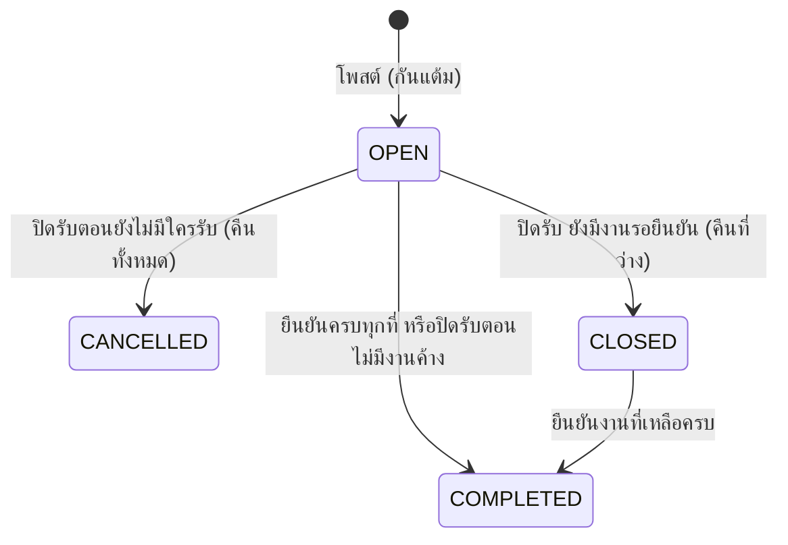
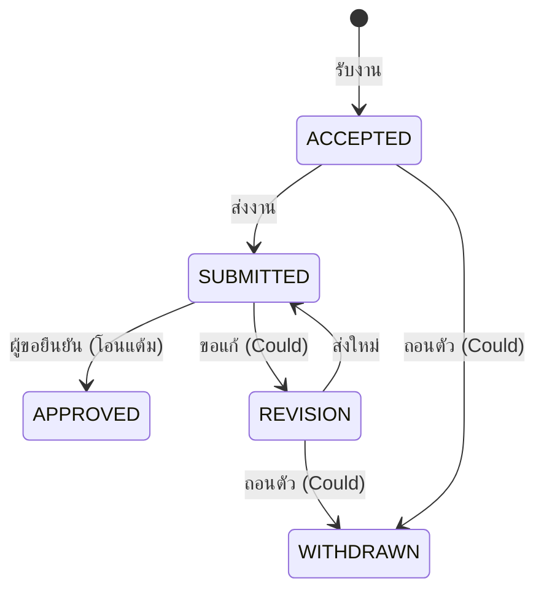

# ระบบทำงานยังไง

ชื่อ class, attribute และ function ที่เขียนไว้ในหน้านี้ใช้ร่วมกันทุกชุด ก่อนเริ่มเขียน code อ่านหน้านี้ก่อน ถ้าจะเปลี่ยนชื่อต้องเปิด Issue ก่อน (ดู `docs/05-contracts.md` ข้อ 9) ส่วนสัญญาว่าใครเรียกใครแล้วได้อะไรกลับมา อยู่ใน `docs/05-contracts.md`

## โครงสร้าง folder

```text
ChuayNoi/
├── main.py                  จุดเริ่มโปรแกรม (python main.py)
├── chuaynoi/                code ทั้งหมดอยู่ใน package นี้
│   ├── app.py               หน้าแรกกับเมนูหลัก เชื่อมทุก feature        แกนกลาง
│   ├── config.py            ค่าคงที่และ rule ทั้งหมด                    ใช้ร่วมกัน
│   ├── core/
│   │   ├── models.py        class ข้อมูล 4 class                        แกนกลาง
│   │   └── storage.py       AppData กับอ่าน/เขียนไฟล์                  แกนกลาง
│   ├── ui/
│   │   ├── inputs.py        รับและตรวจสิ่งที่ผู้ใช้พิมพ์                  ชุด B
│   │   └── display.py       ตารางกับหัวจอที่รองรับภาษาไทย               แกนกลาง
│   ├── accounts/            สมัครและ login                              ชุด B
│   │   ├── service.py
│   │   └── menu.py
│   ├── wallet/              แต้มน้ำใจ                                   แกนกลาง
│   │   ├── service.py
│   │   └── menu.py
│   ├── board/               ประกาศและการช่วยงาน                         ชุด A
│   │   ├── service.py
│   │   ├── search.py
│   │   └── menu.py
│   └── reports/             สถิติและส่งออก .txt                         ชุด B
│       ├── service.py
│       └── menu.py
├── sample_data/             ข้อมูลตัวอย่าง (ขึ้น Git)
├── data/                    ข้อมูลที่โปรแกรมใช้จริง (ไม่ขึ้น Git สร้างด้วย tools/reset_data.py)
├── reports/                 ไฟล์ .txt ที่โปรแกรมส่งออก
├── tools/reset_data.py      รีเซ็ต data/ ให้เป็นข้อมูลตัวอย่าง
└── docs/                    เอกสารของทีม
```

ทุก feature มี 2 ไฟล์เสมอ

| ไฟล์ | ทำอะไร | ห้ามทำอะไร |
| --- | --- | --- |
| `service.py` | rule กับการแก้ data รับค่าเข้ามาแล้วคืนค่าออกไป | `input()` กับ `print()` |
| `menu.py` | หน้าจอ: ถามผู้ใช้ เรียก service แสดงผล แล้ว save ไฟล์ | เขียน rule ซ้ำ ให้เรียก service แทน |

แยกแบบนี้เพราะ service ลองใน Python shell ได้เลย ไม่ต้องพิมพ์ตอบเมนู และคนทำหน้าจอกับคนทำ rule ไม่ต้องแก้ไฟล์เดียวกัน ชั้นไหน import อะไรได้ ดูตารางใน `docs/05-contracts.md` ข้อ 1

## data ไหลยังไง

1. ตอนเปิดโปรแกรม `storage.load_all()` อ่าน CSV ทั้ง 4 ไฟล์มาเก็บไว้ใน `app` (object `AppData`)
2. ระหว่างใช้งาน ทุก function อ่านและแก้ data ผ่าน `app` เช่น `app.requests` คือ list ของประกาศทั้งหมด
3. พอทำรายการสำเร็จ หน้าจอเรียก `storage.save_all(app)` เพื่อเขียนทับไฟล์ แล้วเรียก `storage.append_log(...)` เพิ่มบรรทัดใน log
4. ส่วนแต้ม `add_transaction()` เขียนต่อท้าย `transactions.csv` ทันที ไม่ต้องรอ `save_all`

```python
for request in app.requests:          # วนดูประกาศทุกอัน
    if request.status == config.REQ_OPEN:
        print(request.title, request.reward)

user = app.find_user("9990000001")    # หาผู้ใช้จากรหัส ไม่พบได้ None
available, held = get_balance(app, user.student_id)
```

## คลาสและ attribute

### AppData

อยู่ใน `core/storage.py` เก็บ data ทั้งหมดตอนโปรแกรมรัน

| attribute | type | คืออะไร |
| --- | --- | --- |
| `users` | list ของ `User` | ผู้ใช้ทุกคน |
| `requests` | list ของ `HelpRequest` | ประกาศทุกอัน |
| `engagements` | list ของ `Engagement` | ผู้ช่วยทุกคนในทุกประกาศ |
| `transactions` | list ของ `Transaction` | รายการแต้มทุกรายการ |
| `current_user_id` | str | รหัสนักศึกษาของคนที่ login อยู่ `""` คือยังไม่มีใคร |
| `skipped_rows` | int | จำนวนแถวเสียที่ข้ามไปตอน load |

method: `find_user(student_id)`, `find_request(request_id)`, `find_engagement(engagement_id)` คืน object หรือ `None` ส่วน `next_id(prefix, existing_ids, digits)` สร้างรหัสถัดไป

### User

นักศึกษาหนึ่งคน

| attribute | type | ตัวอย่าง |
| --- | --- | --- |
| `student_id` | str (ตัวเลข 10 หลัก) | `"9990000001"` |
| `name` | str | `"มะลิ ใจดี"` |
| `faculty` | str (อยู่ใน `config.FACULTIES`) | `"บริหารธุรกิจ"` |
| `skills` | list ของ str | `["Python", "ออกแบบสไลด์"]` |
| `created_at` | str | `"2026-11-20 09:00"` |

### HelpRequest

ประกาศหนึ่งอัน

| attribute | type | ตัวอย่าง |
| --- | --- | --- |
| `request_id` | str | `"R0001"` |
| `owner_id` | str | `"9990000001"` |
| `title` | str (5–60 ตัวอักษร) | `"ช่วยทดสอบเว็บร้านกาแฟของโปรเจกต์จบ"` |
| `detail` | str (0–300 ตัวอักษร) | |
| `category` | str (อยู่ใน `config.CATEGORIES`) | `"ทดสอบเว็บ/แอป"` |
| `reward` | int (5–100) | `15` |
| `slots` | int (1–10) | `3` |
| `minutes` | int (5–120) | `20` |
| `status` | str (อยู่ใน `config.REQUEST_STATUSES`) | `"OPEN"` |
| `created_at` | str | |

method: `total_cost()` คือ `reward * slots` ส่วน `count_used_slots(engagements)` คือจำนวน slot ที่ใช้ไปแล้ว นับ engagement ของประกาศนี้ที่ status อยู่ใน `config.ACTIVE_ENGAGEMENT_STATUSES` (`ACCEPTED`, `SUBMITTED`, `REVISION`) รวมกับ `APPROVED`

### Engagement

ผู้ช่วยหนึ่งคนในประกาศหนึ่งอัน

| attribute | type | ตัวอย่าง |
| --- | --- | --- |
| `engagement_id` | str | `"E0001"` |
| `request_id` | str | `"R0001"` |
| `helper_id` | str | `"9990000002"` |
| `status` | str (อยู่ใน `config.ENGAGEMENT_STATUSES`) | `"ACCEPTED"` |
| `result` | str ผลงานที่ส่งมา | `""` ถ้ายังไม่ส่ง |
| `revisions` | int | `0` |
| `updated_at` | str | |

method: `change_status(new_status)` เปลี่ยน status ตาม rule ถ้าเปลี่ยนไม่ได้ raise `ValueError`

### Transaction

รายการแต้มหนึ่งรายการ

| attribute | type | ตัวอย่าง |
| --- | --- | --- |
| `txn_id` | str | `"T000005"` |
| `created_at` | str | |
| `student_id` | str | |
| `kind` | str (อยู่ใน `config.TRANSACTION_KINDS`) | `"HOLD"` |
| `d_available` | int แต้มใช้ได้ที่เปลี่ยนไป | `-45` |
| `d_held` | int แต้มกันไว้ที่เปลี่ยนไป | `45` |
| `request_id` | str (`""` ได้) | `"R0001"` |
| `note` | str | `"กันแต้ม 15 x 3 คน"` |

## ไฟล์ data

| ไฟล์ | เก็บอะไร | เขียนแบบไหน |
| --- | --- | --- |
| `data/users.csv` | ผู้ใช้ | เขียนทับทั้งไฟล์ (`"w"`) |
| `data/requests.csv` | ประกาศ | เขียนทับทั้งไฟล์ (`"w"`) |
| `data/engagements.csv` | ผู้ช่วยในแต่ละประกาศ | เขียนทับทั้งไฟล์ (`"w"`) |
| `data/transactions.csv` | รายการแต้ม | ต่อท้าย (`"a"`) ไม่แก้รายการเก่า |
| `data/activity_log.txt` | log ทุก action (รูปแบบอยู่ใน `docs/05-contracts.md` ข้อ 5) | ต่อท้าย (`"a"`) |
| `reports/summary_*.txt` | รายงานที่ส่งออก | เขียนใหม่ทุกครั้ง (`"w"`) |

- column ของแต่ละไฟล์อยู่ใน `config.py` (`USER_FIELDS`, `REQUEST_FIELDS`, `ENGAGEMENT_FIELDS`, `TRANSACTION_FIELDS`) เรียงเหมือนตาราง attribute ด้านบน
- เปิด CSV ด้วย `encoding=config.CSV_ENCODING` (ค่าคือ `"utf-8-sig"`) กับ `newline=""` ทุกครั้ง Excel จะอ่านภาษาไทยออก และไม่มีบรรทัดว่างแทรก
- `skills` ใน CSV คั่นด้วย `config.SKILL_SEPARATOR` (`;`)
- วันที่เวลาใน data กับบนจอเป็นรูปแบบ `config.TIME_FORMAT` ปี ค.ศ. เช่น `2026-11-20 09:00` ส่วนวันที่ในเอกสารเขียนปี พ.ศ. เช่น 21 ธ.ค. 2569

## ข้อมูลตัวอย่าง

`sample_data/` เป็นข้อมูลสมมติ ใช้เป็นจุดเริ่มของทุก test รหัสนักศึกษาขึ้นต้นด้วย `999` และ `python tools/reset_data.py` copy ไปไว้ที่ `data/`

| รหัส | ชื่อ | ใช้ได้ | กันไว้ |
| --- | --- | ---: | ---: |
| `9990000001` | มะลิ ใจดี | 55 | 30 |
| `9990000002` | ต้นกล้า รักเรียน | 95 | 20 |
| `9990000003` | ฟ้าใส สดใส | 100 | 0 |
| `9990000004` | ภูผา มั่นคง | 75 | 25 |

แต้มรวมทุกคน (ใช้ได้ + กันไว้) เท่ากับ 400

| ประกาศ | ของใคร | หมวด | แต้ม × คน | status |
| --- | --- | --- | --- | --- |
| `R0001` | `9990000001` | ทดสอบเว็บ/แอป | 15 × 3 | `OPEN` |
| `R0002` | `9990000002` | ตรวจสไลด์/เอกสาร | 20 × 1 | `OPEN` |
| `R0003` | `9990000004` | ตอบแบบสอบถาม | 5 × 5 | `OPEN` |

| งานที่รับ | ประกาศ | ผู้ช่วย | status |
| --- | --- | --- | --- |
| `E0001` | `R0001` | `9990000002` | `APPROVED` |
| `E0002` | `R0001` | `9990000003` | `SUBMITTED` |

รายการแต้ม `T000001`–`T000009` ตรงกับตารางข้างบน ส่วน log ไม่มีไฟล์ใน `sample_data/` (ถ้านับตามเหตุการณ์ในตารางจะได้ 12 บรรทัด)

## Status

ประกาศ (`HelpRequest`)



ผู้ช่วยแต่ละคน (`Engagement`) เปลี่ยน status ได้แค่ตาม `config.ALLOWED_TRANSITIONS`



## รายการแต้ม

| `kind` | เกิดตอนไหน | `d_available` | `d_held` |
| --- | --- | ---: | ---: |
| `SIGNUP` | สมัครใหม่ | +100 | 0 |
| `HOLD` | โพสต์ประกาศ | −(reward × slots) | +(reward × slots) |
| `PAY` | ผู้ขอยืนยันงาน (ฝั่งผู้ขอ) | 0 | −reward |
| `EARN` | ผู้ขอยืนยันงาน (ฝั่งผู้ช่วย) | +reward | 0 |
| `REFUND` | ปิดรับ คืนที่ว่าง | +คืน | −คืน |

ยอดแต้มของแต่ละคนคือผลรวม `d_available` กับผลรวม `d_held` จากทุกรายการของคนนั้น แต้มขยับได้ทางเดียวคือ `add_transaction()` ค่า note และตัวแปรของแต่ละเหตุการณ์อยู่ใน `docs/05-contracts.md` ข้อ 6

## หน้าตาบนจอ

- หน้าจอกว้าง 64 ตัวอักษร (`config.SCREEN_WIDTH`) ใช้ `=` กับ `-` ตีเส้น
- ข้อความขึ้นต้น `[OK]` เมื่อสำเร็จ `[!]` เมื่อมี error และ `[i]` เมื่อเป็นข้อมูลทั่วไป
- เมนูพิมพ์ด้วย `display.print_menu(ตัวเลือก, "กลับ")` ทุกหน้าจะหน้าตาเหมือนกัน
- ตอนถามบอกด้วยว่ารับอะไร เช่น `แต้มต่อคน (5-100):`
- header ของแต่ละหน้า กับเรื่องไหนต้องถาม y/n ก่อน อยู่ใน `docs/05-contracts.md` ข้อ 4

หน้าตาของเมนูหลักตอน `9990000001` login อยู่ (ตัวอย่างพิมพ์ผิดต่อท้ายเป็นข้อความจาก `input_int` ของชุด B)

```text
================================================================
 ChuayNoi | เมนูหลัก    ผู้ใช้: มะลิ ใจดี (9990000001)
 ใช้ได้ 55 | กันไว้ 30
================================================================
 [1] ดูบอร์ดประกาศ / ค้นหา
 [2] โพสต์ขอความช่วยเหลือ
 [3] งานที่ฉันโพสต์ (ยืนยันงาน / ปิดรับ)
 [4] งานที่ฉันรับช่วย (ส่งงาน)
 [5] กระเป๋าแต้มและประวัติ
 [6] สรุปสถิติ / ส่งออกรายงาน .txt
 [7] สลับผู้ใช้
 [0] บันทึกและออก
----------------------------------------------------------------
เลือกเมนู (0-7): abc
[!] กรุณาพิมพ์ตัวเลข
เลือกเมนู (0-7):
```

## ข้อตกลงตอนเขียน code

### กฎเหล็ก

1. `service.py` กับ `search.py` ไม่มี `input()` และ `print()`
2. เช็กกฎให้ครบก่อน ผ่านแล้วค่อยแก้ data ผิดข้อไหน data ต้องเหมือนเดิม
3. ตัวเลขกับตัวเลือกเอามาจาก `config.py` ไม่พิมพ์ตัวเลขลอย ๆ
4. แต้มขยับผ่าน `add_transaction()` เท่านั้น แต้มรวม (ใช้ได้ + กันไว้) ของทุกคน = 100 × จำนวนผู้ใช้เสมอ
5. ห้ามเปลี่ยนชื่อหรือ parameter ของ function ที่มีอยู่ และไม่แก้ไฟล์ของชุดอื่น
6. เปิด CSV ทุกครั้งใส่ `newline=""` กับ `encoding=config.CSV_ENCODING`
7. ไม่เขียน `except:` เปล่า ๆ และไม่จับ `KeyboardInterrupt` (ให้ `app.run()` จัดการ)

### ที่เหลือ

- service ของ board กับ accounts คืน `(success, message)` เช่น `(False, "แต้มไม่พอ ต้องใช้ 60 มี 55")` function ของแกนกลางกับ reports คืนค่าตามที่เขียนไว้ใน `docs/05-contracts.md` ข้อ 2 และใน `docs/tasks/b-accounts-reports.md`
- import แบบเขียนชื่อ package เต็ม เช่น `from chuaynoi.wallet.service import get_balance`
- ชื่อตัวแปรกับ function เป็น English แบบ `snake_case` ข้อความบนจอกับ docstring เป็นภาษาไทย
- function หนึ่งตัวไม่ควรยาวเกิน 40 บรรทัด ไม่นับ docstring ถ้ายาวกว่านั้นให้แยกเป็น function ย่อย
- ใช้ได้แค่ `csv`, `os`, `datetime`, `unicodedata` กับของที่มากับ Python ข้อนี้ใช้กับ `chuaynoi/` ส่วน `tools/reset_data.py` เป็น tool ของทีม ไม่ได้ส่งไปกับโปรแกรม จึงใช้ `shutil` กับ `sys` ได้
- code ต้องรันได้บน Python 3.10 ขึ้นไป และต้อง test บน Windows อย่างน้อยหนึ่งรอบ
- docstring ภาษาไทยแบบสั้น: บรรทัดแรกสรุปด้วยกริยา แล้วตามด้วย `รับ:`, `คืน:`, `แก้ data:`, `error:`, `ดู:` เฉพาะที่มีเรื่องให้บอก (ไฟล์ของชุด A กับ B มี `กฎ:` ต่อท้าย `คืน:` และหน้าจอมี `ถาม:` เพิ่ม)
- ข้อความใหม่ที่พิมพ์บนจอให้สั้น ไม่ขึ้นต้นด้วย "กรุณา" (ข้อความที่ตกลงไว้แล้วใน `docs/05-contracts.md` ใช้ตามนั้น)
- ถ้าต้องแก้ไฟล์ของคนอื่นหรือ `config.py` ให้เปิด Issue ก่อน (`docs/05-contracts.md` ข้อ 9)

## function หลัก 19 ตัว

โจทย์บอกว่ากลุ่ม 3 คนต้องมีอย่างน้อย 6 function (ไม่นับ `main` กับ function ที่แสดงเมนู) ของเรามี 19 ตัว ส่วน function ที่ใน code เขียนไว้ว่า function ช่วย ไม่นับรวม

| ชุด | ไฟล์ | function |
| --- | --- | --- |
| แกนกลาง | `core/storage.py` | `load_csv`, `save_csv`, `append_log` |
| แกนกลาง | `wallet/service.py` | `add_transaction`, `get_balance` |
| แกนกลาง | `ui/display.py` | `display_width`, `print_table` |
| ชุด A | `board/service.py` | `create_request`, `apply_to_request`, `submit_work`, `approve_work`, `close_request` |
| ชุด A | `board/search.py` | `search_requests` |
| ชุด B | `ui/inputs.py` | `input_int`, `input_text`, `input_choice` |
| ชุด B | `accounts/service.py` | `register_user` |
| ชุด B | `reports/service.py` | `summarize_board`, `export_summary_txt` |

## เนื้อหาในวิชาที่ใช้

ตารางนี้ใช้ตอนเขียนรายงานกับตอนอธิบาย code

| เรื่อง | ใช้ตรงไหน |
| --- | --- |
| ตัวแปร, data type, การแปลง type | แต้มเป็น `int`, ข้อความเป็น `str`, ใช้ `int()` ตอนอ่าน CSV |
| ตัวดำเนินการ (operator) | `reward * slots`, `>=` เทียบแต้ม, `and` / `or` ใน rule, `in` หาคำ |
| เงื่อนไข `if / elif / else` | rule ทุกข้อใน `board/service.py`, `accounts/service.py` |
| ลูป `while` | เมนู, ถามซ้ำจนกว่าจะพิมพ์ถูกใน `ui/inputs.py` |
| ลูป `for` | รวมแต้ม, ค้นหา, นับสถิติ |
| function | function หลัก 19 ตัว มี parameter, ค่า default และ return value |
| List / Tuple / Dictionary | list ใน `app`, tuple ใน `config`, dict ใน `ALLOWED_TRANSITIONS` และในสถิติ |
| ไฟล์ | อ่าน `"r"`, เขียนทับ `"w"`, เพิ่มต่อท้าย `"a"` ทั้ง `.csv` และ `.txt` |
| จัดการ error | `try / except` กับ `ValueError`, `KeyError`, `OSError` ส่วน `KeyboardInterrupt` จับที่เดียวคือ `app.run()` |
| class และ object | 5 class: 4 class ใน `core/models.py` กับ `AppData` ใน `core/storage.py` |
