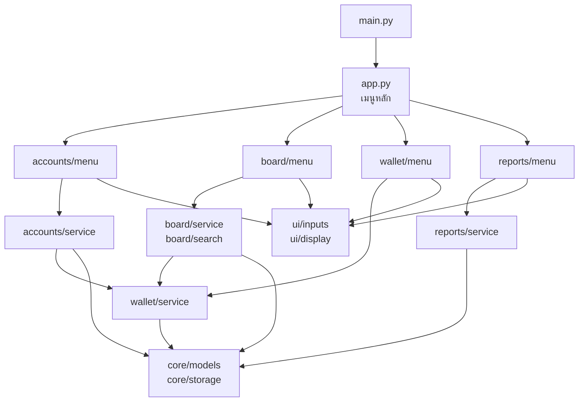
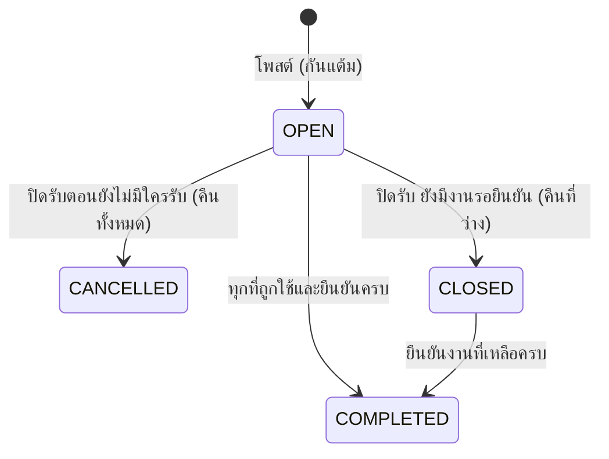
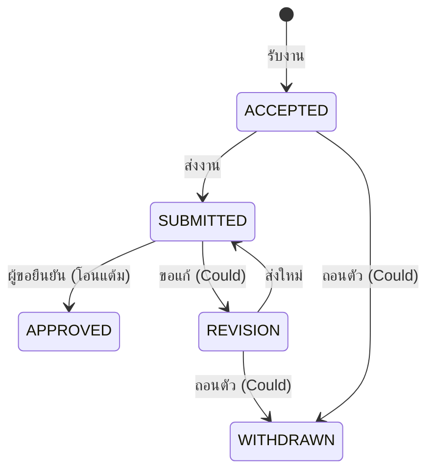

# 02: ระบบทำงานยังไง

อ่านอันนี้ก่อนเริ่มเขียน code นะ ทุกชุดต้องใช้ชื่อ class, attribute และ function ตามที่เขียนไว้ในนี้ ถ้าจะเปลี่ยนอะไรต้องบอกทีมก่อน

## 1. โครงสร้าง folder

```text
ChuayNoi/
├── main.py                  จุดเริ่มโปรแกรม (python main.py)
├── chuaynoi/                โค้ดทั้งหมดอยู่ในแพ็กเกจนี้
│   ├── app.py               เมนูหลัก เชื่อมทุกฟีเจอร์                 แกนกลาง
│   ├── config.py            ค่าคงที่และกติกาทั้งหมด                    ใช้ร่วมกัน
│   ├── core/
│   │   ├── models.py        คลาสข้อมูล 4 คลาส                         แกนกลาง
│   │   └── storage.py       AppData + อ่าน/เขียนไฟล์                  แกนกลาง
│   ├── ui/
│   │   ├── inputs.py        รับและตรวจข้อมูลที่ผู้ใช้พิมพ์               ชุด B
│   │   └── display.py       ตารางและหัวจอ รองรับภาษาไทย              แกนกลาง
│   ├── accounts/            สมัคร / เข้าสู่ระบบ                       ชุด B
│   │   ├── service.py
│   │   └── menu.py
│   ├── wallet/              แต้มน้ำใจ                                แกนกลาง
│   │   ├── service.py
│   │   └── menu.py
│   ├── board/               ประกาศและการช่วยงาน                      ชุด A
│   │   ├── service.py
│   │   ├── search.py
│   │   └── menu.py
│   └── reports/             สถิติและส่งออก .txt                       ชุด B
│       ├── service.py
│       └── menu.py
├── sample_data/             ข้อมูลตัวอย่าง (ขึ้น Git)
├── data/                    ข้อมูลที่โปรแกรมใช้จริง (ไม่ขึ้น Git สร้างด้วย tools/reset_data.py)
├── reports/                 ไฟล์ .txt ที่โปรแกรมส่งออก
├── tools/reset_data.py      รีเซ็ต data/ ให้เป็นข้อมูลตัวอย่าง
└── docs/                    เอกสารของทีม
```

ทุก feature จะมี 2 ไฟล์เสมอ

| ไฟล์ | ทำอะไร | ห้ามทำอะไร |
| --- | --- | --- |
| `service.py` | rule กับการแก้ data รับค่าเข้ามาแล้ว return ค่าออกไป | ห้ามใช้ `input()` กับ `print()` |
| `menu.py` | ส่วนหน้าจอ: ถามผู้ใช้, เรียก service, แสดงผล แล้วค่อย save ไฟล์ | ห้ามเขียน rule ซ้ำ ให้เรียก service เอา |

ที่แยกแบบนี้เพราะ service จะ test ใน Python shell ได้เลย ไม่ต้องมานั่งพิมพ์ตอบเมนู อีกอย่างคือคนทำหน้าจอกับคนทำ rule จะได้ไม่ต้องแก้ไฟล์เดียวกัน

## 2. ใครเรียกใคร



- แต้มจะเปลี่ยนตรงไหนก็ตาม **ต้องผ่าน `wallet/service.add_transaction()` เท่านั้น** ห้ามไปคิดแต้มเองที่อื่น
- ทุกหน้าจอต้องถามผู้ใช้ผ่าน `ui/inputs` ห้ามเรียก `input()` ตรง ๆ ในเมนู

## 3. data ไหลยังไง

1. ตอนเปิดโปรแกรม `storage.load_all()` จะอ่าน CSV ทั้ง 4 ไฟล์มาเก็บไว้ใน `app` (เป็น object `AppData`)
2. ระหว่างใช้งาน ทุก function อ่านและแก้ data ผ่าน `app` อย่าง `app.requests` ก็คือ list ของประกาศทั้งหมด
3. พอทำรายการสำเร็จ เมนูจะเรียก `storage.save_all(app)` เพื่อเขียนทับไฟล์ และเรียก `storage.append_log(...)` เพื่อเพิ่มบรรทัดใน log
4. ส่วนแต้ม `add_transaction()` จะเขียนต่อท้าย `transactions.csv` ทันทีเลย ไม่ต้องรอ `save_all`

ตัวอย่างการใช้ `app` ใน code

```python
for request in app.requests:          # วนดูประกาศทุกอัน
    if request.status == config.REQ_OPEN:
        print(request.title, request.reward)

user = app.find_user("9990000001")    # หาผู้ใช้จากรหัส (ไม่พบได้ None)
available, held = get_balance(app, user.student_id)
```

## 4. คลาสและ attribute

**AppData** (`core/storage.py`) เก็บข้อมูลทั้งหมดตอนโปรแกรมรันอยู่

| attribute | type | คืออะไร |
| --- | --- | --- |
| `users` | list ของ `User` | ผู้ใช้ทุกคน |
| `requests` | list ของ `HelpRequest` | ประกาศทุกอัน |
| `engagements` | list ของ `Engagement` | ผู้ช่วยทุกคนในทุกประกาศ |
| `transactions` | list ของ `Transaction` | รายการแต้มทุกรายการ |
| `current_user_id` | str | รหัสนักศึกษาของคนที่ login อยู่ (`""` คือยังไม่มีใคร login) |
| `skipped_rows` | int | จำนวนแถวเสียที่ข้ามไปตอน load |

method ที่มี: `find_user(student_id)`, `find_request(request_id)`, `find_engagement(engagement_id)` จะ return object หรือ `None` ส่วน `next_id(prefix, existing_ids, digits)` ใช้สร้างรหัสถัดไป

**User** คือนักศึกษาหนึ่งคน

| attribute | type | ตัวอย่าง |
| --- | --- | --- |
| `student_id` | str (ตัวเลข 10 หลัก) | `"9990000001"` |
| `name` | str | `"มะลิ ใจดี"` |
| `faculty` | str (อยู่ใน `config.FACULTIES`) | `"บริหารธุรกิจ"` |
| `skills` | list ของ str | `["Python", "ออกแบบสไลด์"]` |
| `created_at` | str | `"2026-11-20 09:00"` |

**HelpRequest** คือประกาศหนึ่งอัน

| attribute | type | ตัวอย่าง |
| --- | --- | --- |
| `request_id` | str | `"R0001"` |
| `owner_id` | str | `"9990000001"` |
| `title` | str (5–60 ตัวอักษร) | `"ช่วยทดสอบเว็บร้านกาแฟ"` |
| `detail` | str (0–300 ตัวอักษร) | |
| `category` | str (อยู่ใน `config.CATEGORIES`) | `"ทดสอบเว็บ/แอป"` |
| `reward` | int (5–100) | `15` |
| `slots` | int (1–10) | `3` |
| `minutes` | int (5–120) | `20` |
| `status` | str (อยู่ใน `config.REQUEST_STATUSES`) | `"OPEN"` |
| `created_at` | str | |

method: `total_cost()` คือ reward × slots ส่วน `count_used_slots(engagements)` คือจำนวนที่ที่ถูกใช้ไปแล้ว

**Engagement** คือผู้ช่วยหนึ่งคนในประกาศหนึ่งอัน

| attribute | type | ตัวอย่าง |
| --- | --- | --- |
| `engagement_id` | str | `"E0001"` |
| `request_id` | str | `"R0001"` |
| `helper_id` | str | `"9990000002"` |
| `status` | str (อยู่ใน `config.ENGAGEMENT_STATUSES`) | `"ACCEPTED"` |
| `result` | str ผลงานที่ส่งมา | `""` ถ้ายังไม่ส่ง |
| `revisions` | int | `0` |
| `updated_at` | str | |

method: `change_status(new_status)` เปลี่ยน status ตาม rule ถ้าเปลี่ยนไม่ได้จะ `raise ValueError`

**Transaction** คือรายการแต้มหนึ่งรายการ

| attribute | type | ตัวอย่าง |
| --- | --- | --- |
| `txn_id` | str | `"T000005"` |
| `created_at` | str | |
| `student_id` | str | |
| `kind` | str (อยู่ใน `config.TRANSACTION_KINDS`) | `"HOLD"` |
| `d_available` | int แต้มใช้ได้ที่เปลี่ยนไป | `-45` |
| `d_held` | int แต้มกันไว้ที่เปลี่ยนไป | `45` |
| `request_id` | str (`""` ได้) | `"R0001"` |
| `note` | str | `"กันแต้ม 15 x 3 คน"` |

## 5. ไฟล์ data

| ไฟล์ | เก็บอะไร | เขียนแบบไหน |
| --- | --- | --- |
| `data/users.csv` | ผู้ใช้ | เขียนทับทั้งไฟล์ (`"w"`) |
| `data/requests.csv` | ประกาศ | เขียนทับทั้งไฟล์ (`"w"`) |
| `data/engagements.csv` | ผู้ช่วยในแต่ละประกาศ | เขียนทับทั้งไฟล์ (`"w"`) |
| `data/transactions.csv` | รายการแต้ม | append ต่อท้าย (`"a"`) ห้ามแก้รายการเก่า |
| `data/activity_log.txt` | log ทุก action | append ต่อท้าย (`"a"`) |
| `reports/summary_*.txt` | รายงานที่ export ออกมา | เขียนใหม่ทุกครั้ง (`"w"`) |

- column ของแต่ละไฟล์อยู่ใน `config.py` (`USER_FIELDS`, `REQUEST_FIELDS` และตัวอื่น ๆ) เรียงลำดับเหมือนตาราง attribute ข้างบน
- เปิด CSV ด้วย `encoding="utf-8-sig"` กับ `newline=""` ทุกครั้ง Excel จะได้อ่านภาษาไทยออก และไม่มีบรรทัดว่างแทรกมา
- sample data ใน `sample_data/` เป็นข้อมูลสมมติ รหัสนักศึกษาขึ้นต้นด้วย `999`

## 6. Status

ประกาศ (HelpRequest) เปลี่ยน status แบบนี้



ส่วนผู้ช่วยแต่ละคน (Engagement) เปลี่ยน status ได้แค่ตามที่เขียนไว้ใน `config.ALLOWED_TRANSITIONS`



## 7. รายการแต้ม

| `kind` | เกิดตอนไหน | `d_available` | `d_held` |
| --- | --- | ---: | ---: |
| `SIGNUP` | สมัครใหม่ | +100 | 0 |
| `HOLD` | โพสต์ประกาศ | −(reward × slots) | +(reward × slots) |
| `PAY` | ผู้ขอยืนยันงาน (ฝั่งผู้ขอ) | 0 | −reward |
| `EARN` | ผู้ขอยืนยันงาน (ฝั่งผู้ช่วย) | +reward | 0 |
| `REFUND` | ปิดรับ คืนที่ว่าง | +คืน | −คืน |

ยอดแต้มของแต่ละคน ก็คือผลรวม `d_available` กับผลรวม `d_held` จากทุกรายการของคนนั้น

## 8. หน้าจอ

1. หน้าจอกว้าง 64 ตัวอักษร ใช้ `=` กับ `-` ตีเส้น
2. ทุกหน้าต้องมี header บอกชื่อหน้า ผู้ใช้ และยอดแต้ม
3. output ขึ้นต้นด้วย `[OK]` ถ้าสำเร็จ, `[!]` ถ้ามี error และ `[i]` ถ้าเป็นข้อมูลทั่วไป
4. ทุกเมนูย่อยต้องมี `[0] กลับ`
5. เวลาถามอะไร ให้บอกเสมอว่ารับ input แบบไหน เช่น `แต้มต่อคน (5-100):`
6. ก่อนยืนยันงานหรือปิดรับ ต้องถาม `ยืนยัน? (y/n)` ทุกครั้ง

```text
================================================================
 ChuayNoi | เมนูหลัก                ผู้ใช้: มะลิ (9990000001)
 แต้มใช้ได้ 55 | กันไว้ 30
================================================================
 [1] ดูบอร์ดประกาศ / ค้นหา
 [2] โพสต์ขอความช่วยเหลือ
 [3] งานที่ฉันโพสต์ (ยืนยันงาน / ปิดรับ)
 [4] งานที่ฉันรับช่วย (ส่งงาน)
 [5] กระเป๋าแต้มและประวัติ
 [6] สรุปสถิติ / ส่งออกรายงาน .txt
 [7] สลับผู้ใช้
 [0] บันทึกและออก
----------------------------------------------------------------
เลือกเมนู (0-7): abc
[!] กรุณาพิมพ์ตัวเลข
เลือกเมนู (0-7):
```

## 9. function หลัก 19 ตัว

โจทย์บอกว่ากลุ่ม 3 คนต้องมีอย่างน้อย 6 function (ไม่นับ `main` กับ function ที่แสดงเมนู) ของเรามี 19 ตัว ส่วน function ที่ใน code เขียนไว้ว่า "ฟังก์ชันช่วย" ไม่นับรวม

| ชุด | ไฟล์ | function |
| --- | --- | --- |
| แกนกลาง | `core/storage.py` | `load_csv`, `save_csv`, `append_log` |
| แกนกลาง | `wallet/service.py` | `add_transaction`, `get_balance` |
| แกนกลาง | `ui/display.py` | `display_width`, `print_table` |
| ชุด A | `board/service.py` | `create_request`, `apply_to_request`, `submit_work`, `approve_work`, `close_request` |
| ชุด A | `board/search.py` | `search_requests` |
| ชุด B | `ui/inputs.py` | `input_int`, `input_text`, `input_choice` |
| ชุด B | `accounts/service.py` | `register_user` |
| ชุด B | `reports/service.py` | `summarize_board`, `export_summary_txt` |

## 10. ข้อตกลงตอนเขียน code

1. function ใน `service.py` ให้ return `(success, message)` เช่น `(False, "แต้มไม่พอ ต้องใช้ 60 มี 55")`
2. **เช็ก rule ให้ครบก่อน แล้วค่อยแก้ data** ถ้าผิด rule ข้อไหน data ต้องเหมือนเดิมทุกอย่าง
3. ตัวเลขกับข้อความที่เป็น rule ให้ดึงจาก `config.py` เช่น `config.REWARD_MIN` ห้ามพิมพ์ `5` ลอย ๆ
4. import แบบเขียนชื่อ package เต็ม เช่น `from chuaynoi.wallet.service import get_balance`
5. ชื่อตัวแปรกับ function ใช้ภาษาอังกฤษแบบ `snake_case` ส่วนข้อความบนจอกับ docstring ใช้ภาษาไทย
6. function นึงไม่ควรยาวเกิน 40 บรรทัดโดยประมาณ ถ้ายาวกว่านั้นให้แยกเป็น function ย่อย
7. ใช้ได้แค่ module ที่มากับ Python (`csv`, `os`, `datetime`, `unicodedata`) จะได้ไม่ต้องลงอะไรเพิ่ม
8. code ต้องรันได้บน Python 3.10 ขึ้นไป และต้อง test บน Windows อย่างน้อยหนึ่งรอบ
9. แก้แค่ไฟล์ของชุดตัวเอง ถ้าต้องไปแก้ไฟล์ของคนอื่นหรือ `config.py` ให้คุยกันใน Issue ก่อน

## 11. เนื้อหาในวิชาที่เราใช้

ตารางนี้เอาไว้ใช้ตอนเขียนรายงาน กับตอนอธิบาย code

| เรื่อง | ใช้ตรงไหน |
| --- | --- |
| ตัวแปร, data type, การแปลง type | แต้มเป็น `int`, ข้อความเป็น `str`, ใช้ `int()` ตอนอ่าน CSV |
| ตัวดำเนินการ (operator) | `reward * slots`, `>=` เทียบแต้ม, `and` / `or` ใน rule, `in` หาคำ |
| เงื่อนไข `if / elif / else` | rule ทุกข้อใน `board/service.py`, `accounts/service.py` |
| ลูป `while` | เมนู, ถามซ้ำจนกว่าจะพิมพ์ถูกใน `ui/inputs.py` |
| ลูป `for` | รวมแต้ม, ค้นหา, นับสถิติ |
| function | function หลัก 19 ตัว มี parameter, ค่า default และ return value |
| List / Tuple / Dictionary | list ใน `app`, tuple ใน `config`, dict ใน `ALLOWED_TRANSITIONS` และในสถิติ |
| ไฟล์ | อ่าน `"r"`, เขียนทับ `"w"`, เพิ่มต่อท้าย `"a"` ทั้ง `.csv` และ `.txt` |
| จัดการ error | `try / except` กับ `ValueError`, `FileNotFoundError`, `PermissionError`, `KeyboardInterrupt` |
| class และ object | 5 class ใน `core/` |
