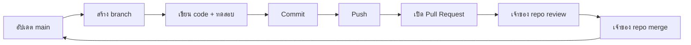

# ทีมเราทำงานกันยังไง

หน้านี้มีวิธีตั้งค่าเครื่องครั้งแรก วิธี push code ขึ้น GitHub ทีละปุ่ม วิธีลองโปรแกรมใน Python shell และตารางงานรายสัปดาห์

## ตั้งค่าครั้งแรก

ทำแค่ครั้งเดียว

1. ลงโปรแกรมพวกนี้
   - Python 3.10 ขึ้นไป โหลดจาก python.org ใครใช้ Windows ตอนลงให้ติ๊ก **Add python.exe to PATH**
   - VS Code ไว้เขียน code
   - GitHub Desktop ไว้ push code ขึ้น GitHub ง่ายกว่าพิมพ์คำสั่ง git เอง
2. สมัคร account GitHub แล้วส่ง username มาให้เจ้าของ repo
3. กดรับ invite ที่ส่งไปทางอีเมล (หรือดูที่ github.com/notifications)
4. Clone repo: เปิด GitHub Desktop แล้ว Sign in ด้วย account GitHub ก่อน จากนั้นเมนู File เลือก Clone repository เลือก `ChuayNoi` แล้วกด Clone
5. เปิดโปรเจกต์: ใน GitHub Desktop เมนู Repository เลือก Open in Visual Studio Code ต้องเปิดทั้ง folder `ChuayNoi` ไม่ใช่ไฟล์เดียว
6. เปิด Terminal ใน VS Code (เมนู Terminal แล้วเลือก New Terminal) แล้วสร้าง data ไว้ test

   ```bash
   python tools/reset_data.py
   ```

7. ลอง run โปรแกรม

   ```bash
   python main.py
   ```

   ถ้าเห็นหน้าแรก แล้วขึ้น `NotImplementedError` ที่มีคำว่า `TODO(ชุด …)` ถือว่าปกติ แปลว่ายังมี function ที่ไม่มีใครเขียน

ใครใช้ macOS พิมพ์ `python3` แทน `python` ทุกคำสั่ง

## เลือกชุดงาน

อ่าน [tasks/README.md](tasks/README.md) แล้วไปที่แท็บ Issues เปิด Issue ของชุดที่อยากทำ กด Assignees เลือก assign yourself แล้ว comment ว่า "เลือกชุดนี้" ตัดสินให้จบภายใน 20 พ.ย. 2569

## ทุกครั้งที่เริ่มงานชิ้นใหม่

ทำทีละ function หรือทีละหน้าจอ เสร็จชิ้นไหนส่งชิ้นนั้น ไม่ต้องรอครบทั้งชุด



`main` เป็น code ตัวจริงที่จะส่งอาจารย์ และถูกล็อกไว้ คนที่ review กับ merge ได้มีแค่เจ้าของ repo คนอื่นเปิด PR ได้อย่างเดียว ปุ่ม merge จะกดไม่ได้ เป็นเรื่องปกติ

### 1. ก่อนเริ่มเขียน

1. เปิด GitHub Desktop เช็กมุมซ้ายบนว่า Current Repository เป็น `ChuayNoi`
2. กด Current Branch แล้วเลือก `main`
3. กด Fetch origin ถ้าปุ่มเปลี่ยนเป็น Pull origin ให้กดอีกที เครื่องจะได้ code ล่าสุด
4. กด Current Branch อีกรอบ เลือก New Branch แล้วตั้งชื่อตามหัวข้อ "ตั้งชื่อ branch กับ commit" ข้างล่าง ต้องแตกออกมาจาก `main`
5. กด Create Branch แล้วกด Open in Visual Studio Code

### 2. ระหว่างเขียน

- แก้เฉพาะไฟล์ของชุดตัวเอง
- run `python tools/reset_data.py` ก่อน แล้ว test ตามไฟล์ของชุดตัวเองใน `docs/tasks/`
- กด Ctrl+S บ่อย ๆ

### 3. เช็กว่าแก้ไฟล์ไหนไปบ้าง

กลับมาที่ GitHub Desktop ดูแท็บ Changes ทางซ้าย ต้องมีแค่ไฟล์ของชุดตัวเอง ถ้ามีไฟล์ที่ไม่ได้ตั้งใจแก้ ให้คลิกขวาที่ไฟล์นั้นแล้วเลือก Discard changes

### 4. Commit

commit คือการเซฟจุดหนึ่งไว้ในเครื่อง ยังไม่ขึ้นเว็บ

1. ช่อง Summary มุมซ้ายล่าง พิมพ์ว่าทำอะไรไป เช่น `feat: input_int`
2. กดปุ่ม Commit to `b/input-int` (ชื่อ branch ของตัวเอง)

### 5. Push

กด Publish branch ด้านบน ถ้าเคย push branch นี้แล้วปุ่มจะเป็น Push origin

### 6. เปิด PR

1. กดปุ่ม Create Pull Request เว็บ GitHub จะเปิดขึ้นมา
2. ด้านบนต้องเป็น `base: main` กับ `compare:` ชื่อ branch ของตัวเอง
3. Title ใส่เหมือน commit เช่น `feat: input_int`
4. ช่องคำอธิบายมีฟอร์มรออยู่แล้ว
   - เลือกชุดของตัวเอง แล้วใส่เลข Issue ของสัปดาห์นั้น (ดูตาราง Issue ในหัวข้อ "ตารางงาน")
   - เขียนว่าทำอะไรไป และ test ยังไง ใส่รหัส test case ได้ เช่น B1, B2
   - ติ๊ก checklist ข้อที่ทำแล้ว
   - PR สุดท้ายของสัปดาห์เขียน `Closes #เลข Issue` (เช่น `Closes #2`) ส่วน PR ก่อนหน้าเขียน `Refs #เลข Issue` (เช่น `Refs #2`) Issue จะได้ไม่ปิดก่อนงานครบ
5. ไม่ต้องใส่ Reviewer ระบบใส่เจ้าของ repo ให้เอง (ตั้งไว้ใน CODEOWNERS)
6. กด Create pull request แล้วส่งลิงก์ PR ในกลุ่ม

### 7. รอ review

- ถ้าเจ้าของ repo ขอให้แก้ จะมี comment ในหน้า PR (แท็บ Conversation กับ Files changed) แก้ใน branch เดิมใน VS Code แล้ว Commit กับ Push origin อีกรอบ PR อัปเดตเอง ไม่ต้องเปิดใหม่
- ถ้าผ่าน เจ้าของ repo กด Squash and merge แล้ว branch ถูกลบให้อัตโนมัติ
- ระหว่างรอ เริ่มงานชิ้นต่อไปได้ สร้าง branch ใหม่จาก `main` แต่ถ้าชิ้นใหม่ต้องใช้ code ใน PR ที่ยังไม่ merge ให้รอก่อน หรือถามในกลุ่ม

### 8. หลัง merge

ใน GitHub Desktop เลือก `main` แล้วกด Fetch origin ตามด้วย Pull origin ส่วน branch เก่าในเครื่องลบทิ้งได้ (เมนู Branch แล้วเลือก Delete)

## ตั้งชื่อ branch กับ commit

| ชุด | ชื่อ branch |
| --- | --- |
| แกนกลาง | `core/ชื่องาน` เช่น `core/models` |
| ชุด A | `a/ชื่องาน` เช่น `a/create-request` |
| ชุด B | `b/ชื่องาน` เช่น `b/input-int` |

ชื่อ branch ใช้ตัวพิมพ์เล็กทั้งหมด และใช้ขีดกลางแทนช่องว่าง commit message ขึ้นต้นด้วยประเภทงาน

| ประเภท | ใช้ตอน | ตัวอย่าง |
| --- | --- | --- |
| `feat:` | เพิ่ม function หรือหน้าจอ | `feat: create_request ตรวจแต้มและกันแต้ม` |
| `fix:` | แก้ bug | `fix: input_int รับเลขติดลบผิด` |
| `docs:` | แก้ doc | `docs: เพิ่มผลทดสอบ A1–A5` |
| `refactor:` | จัด code ใหม่โดยพฤติกรรมเหมือนเดิม | `refactor: ย้าย print_menu ไป display.py` |
| `chore:` | งานจุกจิกอื่น ๆ | `chore: อัปเดตข้อมูลตัวอย่าง` |

## ปัญหาที่เจอบ่อย

| เจออะไร | ทำยังไง |
| --- | --- |
| ลืมสร้าง branch แก้บน `main` ไปแล้วแต่ยังไม่ commit | สร้าง branch ใหม่ได้เลย GitHub Desktop จะถาม ให้เลือก Bring my changes to (ชื่อ branch ใหม่) |
| เผลอ commit บน `main` ไปแล้ว | กด Undo ตรงมุมซ้ายล่าง (ขึ้นอยู่หลัง commit) แล้วสร้าง branch ใหม่ ค่อย commit ใหม่ในนั้น push ขึ้น `main` ตรง ๆ ไม่ได้อยู่แล้ว |
| push แล้วขึ้น error เรื่อง rules หรือ permission | เช็กว่า Current Branch เป็น branch ของตัวเอง ไม่ใช่ `main` |
| หน้า PR ขึ้นว่า This branch has conflicts | อย่าแก้เอง บอกในกลุ่ม เจ้าของ repo ช่วย |
| run แล้วขึ้น `ModuleNotFoundError: No module named 'chuaynoi'` | ต้องเปิดทั้ง folder `ChuayNoi` ใน VS Code แล้ว run จาก Terminal ที่อยู่ใน folder นั้น |
| `reset_data.py` บอกว่าคัดลอกไฟล์ไม่ได้ | ปิดไฟล์ใน `data/` ที่เปิดค้างไว้ใน Excel ก่อน แล้ว run ใหม่ |

ไม่แน่ใจอะไร ถามในกลุ่มก่อนกด ไม่มีอะไรพังถาวร เพราะ `main` ล็อกไว้แล้ว

## อ่าน PR ของเพื่อน

คนตัดสินว่า PR ไหน merge ได้มีแค่เจ้าของ repo แต่ทุกคนควรแวะอ่าน PR ของเพื่อนด้วย จะได้เข้าใจ code ทั้งโปรเจกต์ เพราะอาจารย์จะถามภาพรวม

1. อ่านฟอร์ม PR ก่อน ว่าเพื่อนทำอะไรไป test อะไรไปแล้ว
2. ไปแท็บ Files changed อ่านทีละบรรทัด ตรงไหนไม่เข้าใจกด `+` ที่บรรทัดนั้นแล้วถามได้เลย
3. อยากลอง run เอง: ใน GitHub Desktop สลับ Current Branch ไป branch ของเพื่อน แล้ว run โปรแกรม
4. ไม่ต้องกด Approve หรือ Request changes เจออะไรแปลก comment ทิ้งไว้ เจ้าของ repo ดูต่อ

## ลองโปรแกรมใน Python shell

function ใน `service.py` ลองใน Python shell ได้เลย ไม่ต้องรอเมนูเสร็จ

```text
python
>>> from chuaynoi.core import storage
>>> from chuaynoi.wallet.service import get_balance
>>> app = storage.load_all()
>>> get_balance(app, "9990000001")
(55, 30)
>>> exit()
```

เช็กว่าแต้มรวมยังเท่าเดิม (ใน shell เดียวกัน หลัง `app = storage.load_all()`)

```python
sum(sum(get_balance(app, u.student_id)) for u in app.users)
```

หลัง reset ได้ `400`

หน้าจอก็ลองได้ก่อนเมนูหลักเสร็จ ตั้ง `app.current_user_id` เองแล้วเรียกหน้าจอตรง ๆ

```text
>>> from chuaynoi.board import menu
>>> app.current_user_id = "9990000001"
>>> menu.screen_post(app)
```

- ก่อน test ทุกรอบ run `python tools/reset_data.py` ผลจะตรงกับที่เขียนไว้ใน doc
- test ของชุด A กับชุด B เริ่มจาก reset ใหม่คนละรอบ เพราะ B10 เพิ่มผู้ใช้อีกคน แต้มรวมเลยไม่ใช่ 400 แล้ว

## เรื่องใช้ AI

โจทย์กติกาข้อ 6 ให้ใช้ AI ได้ แต่ code ที่ส่งต้องอธิบายเองได้ทุกบรรทัด และผล test กับภาพหน้าจอต้องมาจากการ run จริง AI ในทีมนี้เป็นติวเตอร์ ไม่เขียน function ให้ ตัวเต็มของกติกาอยู่ใน [AGENTS.md](../AGENTS.md) ใช้ AI ครั้งไหนก็จดลง [ai-log.md](ai-log.md)

## ตารางงาน

งานรายสัปดาห์ดูได้ทั้งในแท็บ Milestones ของ Issues และในไฟล์ของชุดตัวเอง

| Milestone | วันครบกำหนด | ทั้งทีมต้องมีอะไรแล้ว |
| --- | --- | --- |
| สัปดาห์ 1: เริ่มต้น | 21 พ.ย. 2569 | ทุกคน run โปรเจกต์ได้และเลือกชุดเรียบร้อย |
| สัปดาห์ 2: ฟังก์ชันชุดแรก | 24 พ.ย. 2569 | function ของสัปดาห์ 2 ตามไฟล์ของแต่ละชุด และ `ui/inputs.py` merge แล้ว |
| สัปดาห์ 3: ครบทุกเมนู | 26 พ.ย. 2569 | ทุก function ทุกเมนูใช้งานได้ และหยุดเพิ่ม feature ใหม่ |
| สัปดาห์ 4: ทดสอบและรายงาน | 28 พ.ย. 2569 | test ครบทุกกรณี แก้ bug แล้วเขียนรายงานส่วนของตัวเอง |
| สัปดาห์ 5: พร้อมส่ง | 29 พ.ย. 2569 | รายงาน PDF คลิป และไฟล์ ZIP พร้อมส่ง |

วันที่ที่อยู่นอกตาราง
- เลือกชุดให้จบภายใน 20 พ.ย. 2569
- แกนกลางส่วน models, storage, wallet ให้เสร็จก่อน 21 พ.ย. 2569
- PR ของ `ui/inputs.py` (ชุด B) merge ภายใน 22 พ.ย. 2569 เพราะทุกหน้าจอเรียกใช้

### แกนกลาง

| สัปดาห์ | ภายใน | Issue | ทำอะไร |
| --- | --- | --- | --- |
| 1 | 21 พ.ย. 2569 | #10 | `core/models.py`, `core/storage.py`, `wallet/service.py`, `ui/display.py` |
| 2 | 24 พ.ย. 2569 | #11 | `app.py` (หน้าแรก เมนูหลัก Ctrl+C), `wallet/menu.py` และ review PR `ui/inputs.py` |
| 3 | 26 พ.ย. 2569 | #12 | รวมทุกเมนูใน `app.py` ทดสอบทั้งโปรแกรม review PR |
| 4 | 28 พ.ย. 2569 | #13 | test C1–C14 และรายงานส่วนแกนกลาง |
| 5 | 29 พ.ย. 2569 | #9 | รวมรายงาน PDF แพ็ก ZIP คลิปส่วนของตัวเอง |

### ชุด A

| สัปดาห์ | ภายใน | Issue | ทำอะไร |
| --- | --- | --- | --- |
| 1 | 21 พ.ย. 2569 | #1 | setup เครื่อง อ่าน doc เขียน `search_requests` และร่าง flowchart ของ `create_request` กับ `approve_work` บนกระดาษ |
| 2 | 24 พ.ย. 2569 | #2 | `create_request`, `apply_to_request`, `submit_work` ทีละ PR |
| 3 | 26 พ.ย. 2569 | #3 | `approve_work`, `close_request` และหน้าจอ 4 หน้า |
| 4 | 28 พ.ย. 2569 | #4 | test A1–A16 และรายงานส่วนชุด A |
| 5 | 29 พ.ย. 2569 | #9 | คลิปส่วนของตัวเอง และส่งรายงานส่วนของตัวเองให้เจ้าของ repo รวม |

### ชุด B

| สัปดาห์ | ภายใน | Issue | ทำอะไร |
| --- | --- | --- | --- |
| 1 | 21 พ.ย. 2569 | #5 | setup เครื่อง อ่าน doc เขียน `ui/inputs.py` ให้ครบทั้ง 4 function (merge ภายใน 22 พ.ย. 2569) |
| 2 | 24 พ.ย. 2569 | #6 | `register_user`, `login_user`, `screen_register`, `screen_login` |
| 3 | 26 พ.ย. 2569 | #7 | `summarize_board`, `export_summary_txt`, `screen_reports` |
| 4 | 28 พ.ย. 2569 | #8 | test B1–B13 และรายงานส่วนชุด B |
| 5 | 29 พ.ย. 2569 | #9 | คลิปส่วนของตัวเอง และส่งรายงานส่วนของตัวเองให้เจ้าของ repo รวม |

### Issue ของแต่ละสัปดาห์

| # | ชื่อ | Milestone (ครบกำหนด) | Label |
| --- | --- | --- | --- |
| 1 | [ชุด A] สัปดาห์ 1: setup เครื่องกับ search_requests | สัปดาห์ 1: เริ่มต้น (21 พ.ย. 2569) | pkg: A-board, must |
| 2 | [ชุด A] สัปดาห์ 2: create_request, apply_to_request, submit_work | สัปดาห์ 2: ฟังก์ชันชุดแรก (24 พ.ย. 2569) | pkg: A-board, must |
| 3 | [ชุด A] สัปดาห์ 3: approve_work, close_request และหน้าจอ 4 หน้า | สัปดาห์ 3: ครบทุกเมนู (26 พ.ย. 2569) | pkg: A-board, must |
| 4 | [ชุด A] สัปดาห์ 4: test A1–A16 และเขียนรายงาน | สัปดาห์ 4: ทดสอบและรายงาน (28 พ.ย. 2569) | pkg: A-board, must |
| 5 | [ชุด B] สัปดาห์ 1: setup เครื่องกับ ui/inputs.py | สัปดาห์ 1 (21 พ.ย. 2569) | pkg: B-accounts-reports, must |
| 6 | [ชุด B] สัปดาห์ 2: สมัครและ login | สัปดาห์ 2 (24 พ.ย. 2569) | pkg: B-accounts-reports, must |
| 7 | [ชุด B] สัปดาห์ 3: สถิติและ export รายงาน | สัปดาห์ 3 (26 พ.ย. 2569) | pkg: B-accounts-reports, should |
| 8 | [ชุด B] สัปดาห์ 4: test B1–B13 และเขียนรายงาน | สัปดาห์ 4 (28 พ.ย. 2569) | pkg: B-accounts-reports, must |
| 9 | [ทีม] สัปดาห์ 5: รายงาน PDF คลิป และ ZIP | สัปดาห์ 5: พร้อมส่ง (29 พ.ย. 2569) | must, team |
| 10 | [แกนกลาง] สัปดาห์ 1: models, storage, wallet และ display | สัปดาห์ 1 (21 พ.ย. 2569) | pkg: core, must |
| 11 | [แกนกลาง] สัปดาห์ 2: app.py และหน้ากระเป๋าแต้ม | สัปดาห์ 2 (24 พ.ย. 2569) | pkg: core, must |
| 12 | [แกนกลาง] สัปดาห์ 3: รวมทุกเมนูและ review PR | สัปดาห์ 3 (26 พ.ย. 2569) | pkg: core, must |
| 13 | [แกนกลาง] สัปดาห์ 4: test C1–C14 และเขียนรายงาน | สัปดาห์ 4 (28 พ.ย. 2569) | pkg: core, must |
| 14 | [ชุด A] บอร์ดประกาศ: เลือกชุดนี้ได้ | ไม่มี | pkg: A-board, open-to-pick |
| 15 | [ชุด B] ผู้ใช้ การรับข้อมูล และรายงาน: เลือกชุดนี้ได้ | ไม่มี | pkg: B-accounts-reports, open-to-pick |
| 16 | [แกนกลาง] คลาสข้อมูล ไฟล์ แต้ม และเมนูหลัก | ไม่มี | pkg: core |

## ติดปัญหาทำไงดี

- เปิด Issue ใหม่ เลือกฟอร์ม "ถามคำถาม" หรือ "แจ้งบั๊ก" แล้วแนบ error message หรือ screenshot
- อยากให้เพื่อนเปลี่ยน function ที่เราเรียกใช้ คุยกันใน Issue ไม่เข้าไปแก้ไฟล์ของเพื่อนเอง (ขั้นตอนอยู่ใน `docs/05-contracts.md` ข้อ 9)
