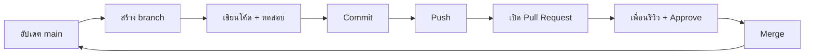

# 03: ทีมเราทำงานกันยังไง

## Setup ครั้งแรก (ทำแค่ครั้งเดียว)

1. ลงโปรแกรมพวกนี้ก่อน
   - Python 3.10 ขึ้นไป โหลดจาก python.org (ใครใช้ Windows ตอนลงอย่าลืมติ๊ก **Add python.exe to PATH**)
   - VS Code ไว้เขียนโค้ด
   - GitHub Desktop ไว้ส่งงานขึ้น GitHub (ง่ายกว่านั่งพิมพ์คำสั่ง git เอง)
2. สมัคร account GitHub แล้วส่ง username มาให้เรา
3. กดรับ invite ที่ส่งไปทางอีเมล (หรือเข้าไปดูที่ github.com/notifications ก็ได้)
4. Clone repo: ใน GitHub Desktop ไปที่ File แล้วเลือก Clone repository เลือก `ChuayNoi` แล้วกด Clone
5. เปิดโปรเจกต์: ใน GitHub Desktop กด Repository แล้วเลือก Open in Visual Studio Code
6. สร้าง data ไว้ test: เปิด Terminal ใน VS Code (เมนู Terminal แล้วเลือก New Terminal) แล้วพิมพ์

   ```bash
   python tools/reset_data.py
   ```

7. ลอง run โปรแกรมดู

   ```bash
   python main.py
   ```

   ถ้ายังไม่มีใครเขียนโค้ด จะเจอ `NotImplementedError: TODO(แกนกลาง): run` อันนี้ปกติ ไม่ต้องตกใจ

> ใครใช้ macOS ให้พิมพ์ `python3` แทน `python` ทุกคำสั่งนะ

## เลือกชุดงาน

อ่าน [tasks/README.md](tasks/README.md) ก่อน แล้วไปที่แท็บ Issues ของ repo เปิด Issue ของชุดที่อยากทำ กด Assignees แล้วเลือก assign yourself จากนั้น comment ว่า "เลือกชุดนี้"

## ทุกครั้งที่เริ่มงานชิ้นใหม่

ทำทีละ function หรือทีละหน้าจอ เสร็จชิ้นนึงก็ส่งชิ้นนึง อย่ารอทำครบทั้งชุดแล้วค่อยส่งทีเดียว



| Step | ทำใน GitHub Desktop ยังไง |
| --- | --- |
| 1. อัปเดต main | ที่ Current Branch เลือก `main` แล้วกด Fetch origin ถ้ามีปุ่ม Pull origin ขึ้นมาก็กดด้วย |
| 2. สร้าง branch | กด Current Branch แล้วเลือก New Branch ตั้งชื่อตามตารางข้างล่าง (แตกออกมาจาก `main`) |
| 3. เขียนโค้ด | แก้ใน VS Code เฉพาะ file ของชุดตัวเอง แล้ว test ตาม doc ของชุดนั้น |
| 4. Commit | ช่อง Summary เขียนว่าทำอะไรไป เช่น `feat: input_int` แล้วกด Commit to … |
| 5. Push | กด Publish branch (ครั้งแรก) หรือ Push origin |
| 6. เปิด PR | กด Create Pull Request เว็บ GitHub จะเปิดขึ้นมา กรอกฟอร์มให้เรียบร้อยแล้วกด Create pull request |
| 7. Review | ใส่ชื่อเพื่อนอีกคนในช่อง Reviewers ให้ช่วย review ถ้ามี comment ก็แก้ตาม |
| 8. Merge | พอได้ Approve แล้วกด **Squash and merge** ต่อด้วย Delete branch |

Heads up: `main` ถูกล็อกไว้ จะ merge ได้ต้องผ่าน Pull Request และได้ Approve จากเพื่อน 1 คนก่อน

### ตั้งชื่อ branch กับ commit

| ชุด | ชื่อ branch |
| --- | --- |
| แกนกลาง | `core/ชื่องาน` เช่น `core/models` |
| ชุด A | `a/ชื่องาน` เช่น `a/create-request` |
| ชุด B | `b/ชื่องาน` เช่น `b/input-int` |

commit message ให้ขึ้นต้นด้วยประเภทของงาน

| ประเภท | ใช้ตอน | ตัวอย่าง |
| --- | --- | --- |
| `feat:` | เพิ่ม function หรือหน้าจอ | `feat: create_request ตรวจแต้มและกันแต้ม` |
| `fix:` | แก้ bug | `fix: input_int รับเลขติดลบผิด` |
| `docs:` | แก้ doc | `docs: เพิ่มผลทดสอบ A1-A5` |
| `chore:` | งานจุกจิกอื่น ๆ | `chore: อัปเดตข้อมูลตัวอย่าง` |

## Review PR ของเพื่อน

ช่วยกัน review ไว้ ทุกคนจะได้เข้าใจโค้ดทั้งโปรเจกต์ เพราะอาจารย์จะถาม

1. อ่านฟอร์ม PR ก่อน ว่าเพื่อนทำอะไรไปบ้าง test อะไรไปแล้ว
2. ไปที่แท็บ Files changed อ่านโค้ดทีละบรรทัด ตรงไหนไม่เข้าใจก็กด `+` ที่บรรทัดนั้นแล้วถามได้เลย
3. ลอง run เอง: ใน GitHub Desktop สลับ Current Branch ไปเป็น branch ของเพื่อน แล้ว run โปรแกรมดู
4. ถ้าโอเคก็กด Review changes แล้วเลือก Approve ถ้ามีอะไรต้องแก้ให้เลือก Request changes แล้วบอกด้วยว่าต้องแก้ตรงไหน

## ลอง function ก่อนมีหน้าจอ

function ใน `service.py` ลองใน Python shell ได้เลย ไม่ต้องรอเมนูเสร็จ

```text
python
>>> from chuaynoi.core import storage
>>> from chuaynoi.wallet.service import get_balance
>>> app = storage.load_all()
>>> get_balance(app, "9990000001")
(55, 30)
>>> exit()
```

ก่อน test ทุกรอบให้ run `python tools/reset_data.py` data จะกลับไปเป็นค่าเริ่มต้น ผลเลยจะตรงกับที่เขียนไว้ใน doc

## เรื่องใช้ AI

โจทย์ข้อ 6 ให้ใช้ AI ได้ แต่มีกติกาตามนี้

- ใช้ AI ครั้งไหนก็จดลง [ai-log.md](ai-log.md) ทันที
- โค้ดที่ส่งต้อง **อธิบายเองได้ทุกบรรทัด** ถ้าอธิบายไม่ได้ก็อย่าส่ง
- ผล test กับภาพหน้าจอต้องมาจากการ run จริง ห้ามให้ AI แต่งให้

## Deadline แต่ละช่วง

งานของแต่ละสัปดาห์ดูได้ทั้งในแท็บ Milestones ของ Issues และใน file ของชุดตัวเอง

| Milestone | Deadline | ทั้งทีมต้องมีอะไรแล้ว |
| --- | --- | --- |
| สัปดาห์ 1: เริ่มต้น | 23 พ.ย. 2569 | ทุกคน run โปรเจกต์ได้และเลือกชุดเรียบร้อย, แกนกลางพร้อมใช้ |
| สัปดาห์ 2: ฟังก์ชันชุดแรก | 30 พ.ย. 2569 | function ของสัปดาห์ 2 ตาม file ของแต่ละชุดเสร็จ, `ui/inputs.py` merge แล้ว |
| สัปดาห์ 3: ครบทุกเมนู | 7 ธ.ค. 2569 | ทุก function ทุกเมนูใช้งานได้ และหยุดเพิ่ม feature ใหม่ |
| สัปดาห์ 4: ทดสอบและรายงาน | 14 ธ.ค. 2569 | test ครบทุกกรณี แก้ bug แล้วเขียนรายงานส่วนของตัวเอง |
| สัปดาห์ 5: พร้อมส่ง | 21 ธ.ค. 2569 | รายงาน PDF คลิป และไฟล์ ZIP พร้อมส่ง |

## ติดปัญหาทำไงดี

- เปิด Issue ใหม่ เลือกฟอร์ม "ถามคำถาม" หรือ "แจ้งบั๊ก" แล้วแนบ error message หรือ screenshot มาด้วย
- ถ้าอยากให้เพื่อนเปลี่ยน function ที่เราเรียกใช้ ให้ไปคุยกันใน Issue อย่าเข้าไปแก้ file ของเพื่อนเอง
