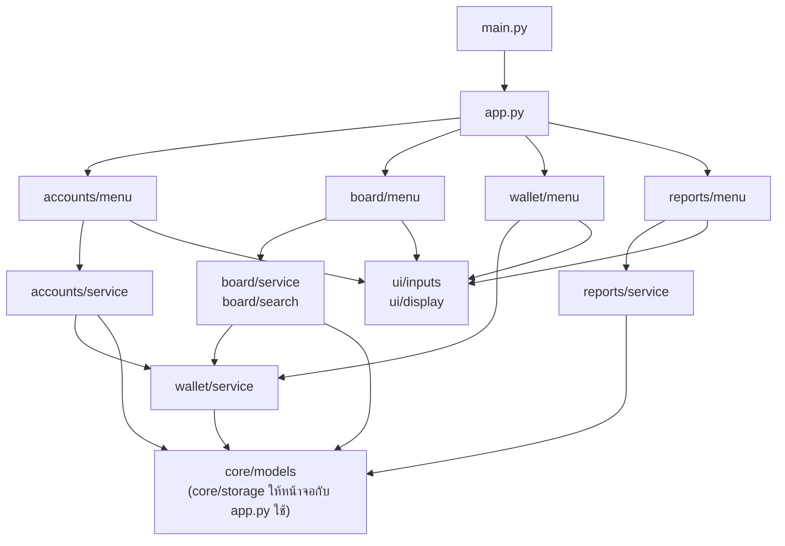

# สัญญาระหว่างชุด

เปิดไฟล์นี้ตอนต้องเรียก code ของชุดอื่น หรือตอน review PR ไม่แน่ใจว่าแกนกลาง ชุด B หรือ `app.py` สัญญาอะไรไว้ ส่วน function ของชุดตัวเองดูใน `docs/tasks/<ชุด>.md`

ตัวย่อที่ใช้ในไฟล์นี้
- `app` คือ object `AppData` ที่ส่งต่อกันทุก function
- `now` คือ `datetime.now().strftime(config.TIME_FORMAT)`
- `{x}` ในข้อความ คือค่าที่ต้องเอามาใส่จากตัวแปรหรือ `config` ไม่พิมพ์เป็นตัวอักษรตายตัว
- service คืนข้อความโดยไม่มี prefix หน้าจอเป็นคนใส่ `[OK]`, `[!]`, `[i]` เอง

## 1. ใครเรียกใคร

| ชั้น | ไฟล์ | import ได้ | ห้าม |
| --- | --- | --- | --- |
| Entry | `main.py`, `chuaynoi/app.py` | ทุกอย่าง | ไม่มีข้อห้าม |
| หน้าจอ | `*/menu.py` | `config`, `service` กับ `search` ของตัวเอง, `core.storage`, `ui.inputs`, `ui.display`, `wallet.service.get_balance` (ไว้โชว์อย่างเดียว), `os` (เฉพาะ `reports/menu.py` ไว้ใช้ `os.path.basename`) | เรียก `add_transaction`, เขียน rule ซ้ำ, เรียก `exit()` `quit()` `sys.exit()` |
| Service | `*/service.py`, `board/search.py` | `config`, `core.models`, `wallet.service`, `datetime`, `os` (เฉพาะ reports) | `input()`, `print()`, import `ui.*` หรือ `menu` |
| แกนกลาง | `core/*.py`, `wallet/service.py`, `ui/display.py` | `config`, `core.models`, `csv`, `os`, `datetime`, `unicodedata` | import package ของชุดอื่น |



รหัสใหม่ทุกตัวมาจาก `app.next_id(prefix, existing_ids, digits)` โดย R กับ E ใช้ 4 หลัก ส่วน T ใช้ 6 หลัก

## 2. แกนกลางรับประกัน

ตารางนี้ตรวจกับ code ที่มีอยู่แล้ว

| ของ | รับประกันอะไร |
| --- | --- |
| `storage.load_all()` | คืน `AppData` สร้าง `data/` กับ CSV ที่ขาด (มีแต่ header) ข้ามแถวที่ `from_row` ปล่อย `ValueError`, `KeyError`, `TypeError` หรือ `AttributeError` (รวมแถวที่ column ไม่ครบ) แล้วนับใน `app.skipped_rows` |
| `app.users`, `.requests`, `.engagements`, `.transactions` | list ของ object เรียงตามไฟล์ เก่าสุดอยู่หน้า |
| `app.current_user_id` | รหัสของคนที่ login อยู่ ถ้าไม่มีใครเป็น `""` และกลับเป็น `""` ตอน "สลับผู้ใช้" |
| `app.find_user`, `find_request`, `find_engagement` | คืน object ตัวจริง (แก้ที่ได้มา `app` เปลี่ยนด้วย) หรือ `None` |
| `app.next_id(prefix, existing_ids, digits)` | prefix + (เลขมากสุด + 1) เติม 0 ให้ครบหลัก ถ้า list ว่างได้เลข 1 |
| `HelpRequest.total_cost()` | `reward * slots` |
| `HelpRequest.count_used_slots(engagements)` | นับ engagement ของประกาศนี้ที่ status อยู่ใน `ACTIVE_ENGAGEMENT_STATUSES` หรือเป็น `ENG_APPROVED` |
| `Engagement.change_status(new_status)` | ไปได้ตาม `config.ALLOWED_TRANSITIONS` ก็เปลี่ยน ถ้าไม่ได้ raise `ValueError("เปลี่ยน status จาก {old} ไป {new} ไม่ได้")` และไม่แก้อะไร |
| `add_transaction(app, student_id, kind, d_available, d_held, request_id="", note="")` | `kind` ผิด raise `ValueError` และไม่แก้อะไร ถ้าถูก ต่อท้าย `transactions.csv` ก่อน สำเร็จแล้วค่อยเพิ่มใน `app.transactions` แล้วคืน `Transaction` ถ้าเขียนไฟล์ไม่ได้ `OSError` หลุดออกไป และ `app.transactions` ไม่เปลี่ยน |
| `get_balance(app, student_id)` | คืน `(available, held)` เป็น int |
| `list_history(app, student_id, limit=10)` | ใหม่สุดก่อน ไม่เกิน `limit` รายการ |
| `storage.save_all(app)` | เขียนทับ users, requests, engagements คืน `True` หรือ `False` ไม่เคยปล่อย `OSError` |
| `storage.append_log(student_id, action)` | ต่อท้าย `[YYYY-MM-DD HH:MM] {student_id} {action}` ถ้าเขียนไม่ได้พิมพ์ `[!] ไม่สามารถเขียน log ได้: {บรรทัดนั้น}` ไม่ปล่อย `OSError` |
| `display.print_header(title, subtitle="")` | เส้น `=` ยาว 64, ` {title}`, ` {subtitle}` ถ้าไม่ว่าง แล้วเส้น `=` อีกเส้น |
| `display.print_menu(options, zero_label)` | ` [1] …` ถึง ` [n] …` แล้ว ` [0] {zero_label}` แล้วเส้น `-` ยาว 64 |
| `display.print_table(headers, rows)` | ตารางมีเส้นขอบ จัด column ด้วย `display_width` ตัวเลขชิดขวา ไม่ตัดข้อความ ถ้า `rows` ว่างพิมพ์ `[i] ไม่มีข้อมูล` |
| `display.display_width(text)` | อักขระ category `Mn` ได้ 0, ตัวกว้าง `W`/`F` ได้ 2, ที่เหลือ 1 |
| `app.run()`, `main_menu` | ดูข้อ 7 `main_menu` พิมพ์ชื่อกับยอดล่าสุดใหม่ทุกครั้งที่กลับจากหน้าจอ |

feature ระดับ Could คือ `REVISION` กับ `WITHDRAWN` ตอนนี้ไม่มีหน้าจอหรือ function ที่ทำให้เกิด status สองตัวนี้ rule ที่พูดถึงมัน (AP4, `count_used_slots`, ตอนเช็กว่างานครบ) มีไว้ให้ data ยังถูกต้องถ้ามีคนเพิ่ม feature ทีหลัง `revisions` ไม่เคยเปลี่ยน และ `MAX_REVISIONS` ไม่ถูกใช้ ถ้าเพิ่ม withdraw ให้ประกาศที่ปิดแล้ว (CLOSED) ภายหลัง แต้มที่กันไว้ของงานนั้นยังไม่มีทางคืน ต้องคิดตอนเพิ่ม feature

## 3. ui/inputs.py

| function | คืน | รับประกัน | ข้อความ |
| --- | --- | --- | --- |
| `input_int(prompt, min_value, max_value)` | `int` | อยู่ในช่วง ตัด space หัวท้าย ถามใหม่ถ้าเป็นตัวอักษร ว่าง ทศนิยม หรือนอกช่วง | `[!] กรุณาพิมพ์ตัวเลข` กับ `[!] ต้องอยู่ระหว่าง {min_value} ถึง {max_value}` |
| `input_text(prompt, min_len, max_len)` | `str` | ตัด space หัวท้ายแล้ว `min_len <= len(text) <= max_len` (นับด้วย `len` ไม่ใช่ความกว้างบนจอ) | `[!] ต้องยาว {min_len} ถึง {max_len} ตัวอักษร` ถ้า `min_len == 0` ใช้ `[!] ต้องไม่เกิน {max_len} ตัวอักษร` |
| `input_choice(prompt, options)` | `str` | พิมพ์ `prompt` แล้ว `  [1] …` ถึง `  [n] …` แล้วถามด้วย `input_int("พิมพ์หมายเลข (1-{n}): ", 1, n)` คืนตัวเลือกที่เลือก (ไม่ใช่เลขข้อ) `options` เป็น tuple หรือ list ก็ได้ และไม่ถูกแก้ | ใช้ของ `input_int` |
| `input_yes_no(prompt)` | `bool` | ถามด้วย `prompt + " (y/n): "` รับ `y` `yes` (True) `n` `no` (False) ตัวพิมพ์เล็กใหญ่ก็ได้ | `[!] กรุณาพิมพ์ y หรือ n` |

ตัวอย่างข้อความที่เติมค่าแล้ว `input_int("แต้มต่อคน (5-100): ", 5, 100)` ตอบ `4` ได้ `[!] ต้องอยู่ระหว่าง 5 ถึง 100`

- IN1 ผู้เรียกใส่ช่วงตัวเลขไว้ใน `prompt` เอง มีแต่ `input_yes_no` ที่เติม `" (y/n): "` ให้
- IN2 พิมพ์อะไรมาก็ไม่ raise มี `except ValueError:` แค่รอบ `int(...)`
- IN3 `KeyboardInterrupt` ต้องผ่านออกไปถึง `app.run()` ห้ามมี `except:` เปล่า ๆ และห้ามมี `except Exception:` ครอบ `input()`
- IN4 `EOFError` (Ctrl+D, Ctrl+Z แล้ว Enter, หรือ input ที่ pipe เข้ามาหมด) อยู่นอกขอบเขต ไม่จับและไม่ test

## 4. หน้าจอที่ app.py เรียก

กฎกลางของทุกหน้าจอ
- SC1 login กับ register ทำงานตอน `app.current_user_id == ""` หน้าจออื่นทำงานตอนมีคน login อยู่ ไม่ต้องเช็กซ้ำ
- SC2 หน้าจอที่เรียกจากเมนูหลักเริ่มด้วย `display.print_header(title)` โดย title มาจากตารางหน้าจอด้านล่าง (subtitle ใส่เพิ่มได้) login กับ register ไม่พิมพ์ header เพราะหน้าแรกเพิ่งพิมพ์ไป มีแค่เมนูหลักกับกระเป๋าแต้มที่โชว์ชื่อผู้ใช้กับยอด
- SC3 ทุกค่าที่ผู้ใช้พิมพ์ต้องผ่าน `ui.inputs` `input()` ตัวเปล่ามีได้ที่เดียวคือรอ Enter ตอนจบ `input("กด Enter เพื่อกลับเมนูหลัก")` พิมพ์หลังบรรทัดผลลัพธ์ บรรทัด `[i]` หรือการยกเลิก ก่อน return ถ้าผู้ใช้เลือก `0` ตรงไหนก็กลับทันทีโดยไม่รอ Enter (`screen_my_requests` เลือก `0` ที่ระดับไหนก็กลับเมนูหลัก) login กับ register ไม่รอ Enter
- SC4 หนึ่งครั้งที่เข้าหน้าจอ ทำหนึ่ง action
- SC5 สำเร็จ (`True`) พิมพ์ `"[OK] " + message` ไม่สำเร็จ (`False`) พิมพ์ `"[!] " + message` ข้อมูลทั่วไปขึ้นต้น `"[i] "`
- SC6 ก่อนเรียก `create_request`, `apply_to_request`, `approve_work`, `close_request` ต้องถาม `inputs.input_yes_no(...)` (prompt ไม่ต้องมี "(y/n)") ถ้าตอบ n พิมพ์ `[i] ยกเลิกแล้ว` รอ Enter แล้ว return
- SC7 เลือกจากรายการ: โชว์ตารางที่ column แรกชื่อ `ลำดับ` (1 ถึง n) แล้วถาม `inputs.input_int("เลือกลำดับ (0-{n}, 0 = กลับ): ", 0, n)` ถ้ารายการว่าง พิมพ์บรรทัด `[i]` ของหน้านั้น รอ Enter แล้ว return
- SC8 ลำดับคือพิมพ์ผลลัพธ์ก่อน แล้วค่อย save แล้วค่อย log (`screen_register` เรียงต่างออกไป ดูข้อนั้น) หลัง `True` ถ้า data เปลี่ยน (ทุก action ยกเว้น login กับ export) เรียก `storage.save_all(app)` ถ้าได้ `False` พิมพ์ `[!] บันทึกไฟล์ไม่สำเร็จ ถ้าเปิดไฟล์ใน Excel ค้างไว้ให้ปิดก่อน` แล้วทำต่อ จากนั้นเรียก `storage.append_log(app.current_user_id, action)` (ข้อ 5) ห้าม save หรือ log หลัง `False`, ตอบ n หรือเลือก `0` รหัสใหม่สำหรับ log: หลังโพสต์ใช้ `app.requests[-1].request_id` หลังสมัครช่วยใช้ `app.engagements[-1].engagement_id` ที่เหลือใช้รหัสของแถวที่เลือก
- SC9 จบด้วย `return` หน้าจอของ board, wallet, reports คืน `None` (ไม่มีใครอ่านค่า) login กับ register คืน `True` หรือ `False`
- SC10 ห้ามมี `except:` เปล่า ๆ และห้ามจับ `KeyboardInterrupt`
- SC11 หน้าจอไม่เช็ก rule และไม่คิดแต้ม ยกเว้นบรรทัดสรุปใน `screen_post` (โชว์เฉย ๆ ไม่เช็กล่วงหน้า ปล่อยให้ service ปฏิเสธเอง) ห้ามเรียก `add_transaction` จากหน้าจอ
- SC12 ตารางไม่โชว์ข้อความยาว `title` ตัดเหลือ 25 ตัวแรก (`title[:25]`) `detail` กับ `result` ไม่เป็น column ของตารางเลย พอเลือกแถวแล้วให้พิมพ์ข้อความเต็มเป็นบรรทัด `[i]` ก่อนถาม y/n (board: `[i] {title}` กับ `[i] {detail}` ส่วน my requests: `[i] {engagement_id}: {result}` ของทุกงาน ก่อนเลือกงานที่จะยืนยัน)

### หน้าจอทั้งหมด

| หน้าจอ | ของใคร | เรียกจาก | title ใน header |
| --- | --- | --- | --- |
| `screen_login(app)` | ชุด B | หน้าแรก `[1]` | ไม่มี |
| `screen_register(app)` | ชุด B | หน้าแรก `[2]` | ไม่มี |
| `board_menu.screen_board(app)` | ชุด A | เมนูหลัก `[1]` | `ดูบอร์ดประกาศ / ค้นหา` |
| `board_menu.screen_post(app)` | ชุด A | เมนูหลัก `[2]` | `โพสต์ขอความช่วยเหลือ` |
| `board_menu.screen_my_requests(app)` | ชุด A | เมนูหลัก `[3]` | `งานที่ฉันโพสต์` |
| `board_menu.screen_my_jobs(app)` | ชุด A | เมนูหลัก `[4]` | `งานที่ฉันรับช่วย` |
| `wallet_menu.screen_wallet(app)` | แกนกลาง | เมนูหลัก `[5]` | `กระเป๋าแต้มของ {name} ({student_id})` subtitle `ใช้ได้ {available} \| กันไว้ {held}` |
| `reports_menu.screen_reports(app)` | ชุด B | เมนูหลัก `[6]` | `สรุปสถิติ / ส่งออกรายงาน` |

เมนูหลัก `[7]` สลับผู้ใช้: `main_menu` คืน `"logout"` แล้ว `run()` ล้าง `current_user_id` ไม่มีหน้าจอของตัวเอง

### screen_login

- ถาม `input_text("รหัสนักศึกษา (0 = กลับ): ", 1, config.STUDENT_ID_LENGTH)` ถ้าได้ `"0"` คืน `False`
- เรียก `login_user` หนึ่งครั้ง ถ้าไม่ผ่านพิมพ์ `[!] {message}` แล้วคืน `False`
- ผ่านแล้ว log `LOGIN` ไม่ save คืน `True`

### screen_register

1. ถามรหัสแบบเดียวกับ login (`0` = กลับ คืน `False`)
2. ถาม `input_text("ชื่อ-นามสกุล ({NAME_MIN}-{NAME_MAX} ตัวอักษร): ", config.NAME_MIN, config.NAME_MAX)`
3. ถาม `input_choice("เลือกคณะ", config.FACULTIES)`
4. ถาม `input_text("ทักษะ คั่นด้วย , (เว้นว่างได้): ", 0, config.DETAIL_MAX)` แล้วแยกด้วย `,` ตัด space แต่ละตัว ทิ้งตัวที่ว่าง
5. เรียก `register_user` ถ้า `False` พิมพ์ `[!] {message}` แล้วถาม `input_yes_no("ลองใหม่?")` ตอบ y ให้ถามใหม่ตั้งแต่รหัส ตอบ n คืน `False`
6. ถ้า `True` เรียก `save_all` แล้ว `login_user(app, student_id)` แล้ว `append_log(app.current_user_id, "REGISTER")` พิมพ์ `[OK] {message}` คืน `True` สมัครสำเร็จไม่มีบรรทัด `LOGIN` แยก

### screen_board

- header `ดูบอร์ดประกาศ / ค้นหา`
- ถามตามลำดับ
  1. `input_text("คำค้น (เว้นว่างได้): ", 0, config.TITLE_MAX)`
  2. `input_choice("เลือกหมวด", ("ทุกหมวด",) + config.CATEGORIES)`
  3. `input_int("แต้มขั้นต่ำ (0-{REWARD_MAX}): ", 0, config.REWARD_MAX)`
  4. `input_choice("เรียงตาม", SORT_LABELS)`
- เรียก `search_requests(app.requests, keyword, category, min_reward, True, sort_by)` แล้วโชว์ตาราง เลือกแถว (SC7) แล้ว SC12 แล้ว `input_yes_no("สมัครช่วย {request_id}?")` (SC6)
- เรียก `apply_to_request(app, app.current_user_id, request_id)`
- สำเร็จ: save แล้ว log `APPLY {request_id} {engagement_id}`
- คืน `None`

### screen_post

- header `โพสต์ขอความช่วยเหลือ`
- ถามตามลำดับ
  1. `input_text("หัวข้อ ({TITLE_MIN}-{TITLE_MAX} ตัวอักษร): ", config.TITLE_MIN, config.TITLE_MAX)`
  2. `input_text("รายละเอียด (ไม่เกิน {DETAIL_MAX} ตัวอักษร, เว้นว่างได้): ", config.DETAIL_MIN, config.DETAIL_MAX)`
  3. `input_choice("เลือกหมวด", config.CATEGORIES)`
  4. `input_int("แต้มต่อคน ({REWARD_MIN}-{REWARD_MAX}): ", config.REWARD_MIN, config.REWARD_MAX)`
  5. `input_int("จำนวนผู้ช่วย ({SLOTS_MIN}-{SLOTS_MAX}): ", config.SLOTS_MIN, config.SLOTS_MAX)`
  6. `input_int("เวลาโดยประมาณ นาที ({MINUTES_MIN}-{MINUTES_MAX}): ", config.MINUTES_MIN, config.MINUTES_MAX)`
- พิมพ์บรรทัดสรุป `สรุป: กันแต้ม {reward} x {slots} = {cost} แต้ม | ใช้ได้หลังโพสต์ {available - cost} แต้ม` ตัวอย่าง `สรุป: กันแต้ม 10 x 3 = 30 แต้ม | ใช้ได้หลังโพสต์ 25 แต้ม`
- ถาม `input_yes_no("ยืนยันโพสต์?")` แล้วเรียก `create_request`
- สำเร็จ: save แล้ว log `CREATE_REQUEST {request_id}`
- คืน `None`

### screen_my_requests

- header `งานที่ฉันโพสต์`
- โชว์ตารางประกาศของฉัน แล้วเลือกแถว (SC7) แล้ว `print_menu(["ยืนยันงาน", "ปิดรับ"], "กลับ")` กับ `input_int("เลือกเมนู (0-2): ", 0, 2)`
- ยืนยันงาน: โชว์ตารางงานของประกาศนั้น เลือกแถว แล้วถาม `input_yes_no("ยืนยันงาน {engagement_id} และโอน {reward} แต้ม?")` แล้วเรียก `approve_work` สำเร็จ: save แล้ว log `APPROVE {engagement_id}`
- ปิดรับ: ถาม `input_yes_no("ปิดรับ {request_id}?")` แล้วเรียก `close_request` สำเร็จ: save แล้ว log `CLOSE {request_id}`
- ทั้งสอง action โชว์ให้เลือกเสมอ ถ้า action ไหนใช้ไม่ได้ให้ service ปฏิเสธเอง (A11)
- คืน `None`

### screen_my_jobs

- header `งานที่ฉันรับช่วย`
- โชว์ตารางงานที่ฉันรับ เลือกแถว (SC7) แล้วถาม `input_text("ผลงาน (ข้อความหรือลิงก์): ", config.RESULT_MIN, config.RESULT_MAX)` แล้วเรียก `submit_work`
- สำเร็จ: save แล้ว log `SUBMIT {engagement_id}`
- คืน `None`

### screen_wallet

- header ตามตารางด้านบน ไม่ถามอะไร เรียก `get_balance` กับ `list_history` แล้วโชว์ตาราง `เวลา`, `ประเภท`, `ใช้ได้`, `กันไว้`, `หมายเหตุ`
- ไม่ save ไม่ log รอ Enter ตอนจบ คืน `None`
- ข้อยกเว้นของ SC3: หน้านี้ไม่มี `[0] กลับ` เพราะมีแค่การรอ Enter

### screen_reports

- header `สรุปสถิติ / ส่งออกรายงาน`
- เรียก `summarize_board` แล้วโชว์ 4 ตาราง
  1. ภาพรวม (หัวข้อ, ค่า): ผู้ใช้ทั้งหมด, ประกาศทั้งหมด, แต้มที่โอนให้ผู้ช่วยแล้ว, แต้มต่อคนเฉลี่ยต่อประกาศ
  2. หมวด และ จำนวน
  3. status และ จำนวน
  4. อันดับ, ชื่อ, แต้ม, งาน
- ถ้าไม่มีข้อมูลเลย ตารางตัวเลขยังโชว์ 0 ส่วนตารางอันดับจะพิมพ์ `[i] ไม่มีข้อมูล`
- ถาม `input_yes_no("ส่งออกเป็นไฟล์ .txt?")` ถ้าตอบ n รอ Enter แล้ว return โดยไม่พิมพ์อะไร
- ตอบ y เรียก `export_summary_txt(summary)` ถ้าได้ path พิมพ์ `[OK]` พร้อมที่อยู่ไฟล์ แล้ว log `EXPORT_REPORT {file name}` (ชื่อไฟล์ได้จาก `os.path.basename(path)`) ถ้าได้ `""` พิมพ์ `[!] ส่งออกไม่สำเร็จ` และไม่ log
- ไม่ save คืน `None`

### ตารางที่ต้องโชว์ กับบรรทัดตอนว่าง

| หน้าจอ | column ของตาราง | ถ้ารายการว่าง |
| --- | --- | --- |
| board | ลำดับ, รหัส, หัวข้อ (25 ตัว), แต้ม, ที่ว่าง, นาที | `[i] ไม่พบประกาศที่ตรงเงื่อนไข` (เช็ก `len(results) == 0` ก่อนเรียก `print_table`) |
| my requests | ลำดับ, รหัส, หัวข้อ (25 ตัว), แต้ม, ใช้ไป/ทั้งหมด, status | `[i] ยังไม่มีประกาศของคุณ` |
| งานของประกาศหนึ่งอัน | ลำดับ, รหัสงาน, ผู้ช่วย (ชื่อ), status | `[i] ยังไม่มีผู้ช่วยในประกาศนี้` (โชว์เฉพาะตอนเลือกยืนยันงาน) |
| my jobs | ลำดับ, รหัสงาน, รหัสประกาศ, หัวข้อ (25 ตัว), แต้ม, status | `[i] ยังไม่มีงานที่คุณรับ` |

รายละเอียดอื่น
- `SORT_LABELS` เป็น tuple ในเครื่องของ `board/menu.py` ค่าคือ `("ใหม่สุด", "แต้มมากไปน้อย", "แต้มน้อยไปมาก", "ใช้เวลาน้อยสุด")` เรียงตรงกับ `search.SORT_OPTIONS` คือ `("newest", "reward_high", "reward_low", "minutes_short")` แปลงด้วย `search.SORT_OPTIONS[SORT_LABELS.index(choice)]`
- เลือก "ทุกหมวด" แปลว่าส่ง `""` ให้ `search_requests`
- "ที่ว่าง" คือ `request.slots - request.count_used_slots(app.engagements)`
- บอร์ดโชว์ประกาศของตัวเองด้วย (A1–A3 ต้องเห็น) แต่สมัครช่วยประกาศตัวเองไม่ได้ ถูกปฏิเสธด้วย AP3

## 5. activity log

| เหตุการณ์ | `action` | ตัวอย่าง |
| --- | --- | --- |
| สมัคร | `REGISTER` | `[2026-11-20 09:00] 9990000001 REGISTER` |
| login | `LOGIN` | `[2026-11-25 09:01] 9990000005 LOGIN` |
| โพสต์ | `CREATE_REQUEST {request_id}` | `[2026-11-20 10:00] 9990000001 CREATE_REQUEST R0001` |
| สมัครช่วย | `APPLY {request_id} {engagement_id}` | `[2026-11-20 11:30] 9990000002 APPLY R0001 E0001` |
| ส่งงาน | `SUBMIT {engagement_id}` | `[2026-11-20 14:45] 9990000002 SUBMIT E0001` |
| ยืนยันงาน | `APPROVE {engagement_id}` | `[2026-11-20 15:20] 9990000001 APPROVE E0001` |
| ปิดรับ | `CLOSE {request_id}` | `[2026-11-25 09:45] 9990000001 CLOSE R0001` |
| ส่งออก | `EXPORT_REPORT {file name}` | `[2026-11-25 09:50] 9990000001 EXPORT_REPORT summary_20261125_0950.txt` |

- คนที่ลงชื่อใน log คือ `app.current_user_id` ตอนที่ log
- ไม่ log ตอนที่ทำไม่สำเร็จ, ยกเลิก, เลือก `0`, สลับผู้ใช้ หรือแค่ดู
- บรรทัดที่ลงวันที่ 2026-11-25 เป็นตัวอย่างเฉย ๆ ไม่ได้อยู่ใน `sample_data/`
- C13 ตรวจตารางนี้

## 6. แต้มขยับยังไง

| เกิดตอน | โดย | `kind` | ของใคร | `d_available` | `d_held` | `request_id` | `note` |
| --- | --- | --- | --- | ---: | ---: | --- | --- |
| สมัคร | `register_user` | `config.TXN_SIGNUP` | ผู้ใช้ใหม่ | `+config.START_POINTS` | 0 | `""` | `แต้มเริ่มต้น` |
| โพสต์ | `create_request` | `config.TXN_HOLD` | ผู้ขอ | `-cost` | `+cost` | R ใหม่ | `กันแต้ม {reward} x {slots} คน` |
| ยืนยัน (ฝั่งผู้ขอ) | `approve_work` | `config.TXN_PAY` | ผู้ขอ | 0 | `-reward` | R | `จ่ายให้ {engagement_id}` |
| ยืนยัน (ฝั่งผู้ช่วย) | `approve_work` | `config.TXN_EARN` | ผู้ช่วย | `+reward` | 0 | R | `ได้รับจาก {request_id}` |
| ปิดรับ ถ้ามีที่ว่างเหลือ | `close_request` | `config.TXN_REFUND` | ผู้ขอ | `+refund` | `-refund` | R | `คืนที่ว่าง {unused} ที่` |

- `cost = reward * slots`
- `used = request.count_used_slots(app.engagements)`
- `unused = slots - used`
- `refund = unused * reward`
- ถ้า `unused` เป็น 0 ไม่ต้องเพิ่มแถว REFUND
- note ของสมัคร โพสต์ และยืนยัน เหมือนใน `sample_data/transactions.csv` (T000001–T000009) ส่วน note ของ REFUND เป็นแบบใหม่ที่ตกลงกันในข้อนี้
- ค่าที่ต้องจริงเสมอ (C2, A16): ผลรวมของ (`available` + `held`) ทุกคน เท่ากับ `config.START_POINTS` × `len(app.users)` หลังทุก action

## 7. Ctrl+C

- `app.run()` ครอบลูปหน้าแรกกับเมนูหลักด้วย `try … except KeyboardInterrupt` กด Ctrl+C ตรงไหนข้างใน จะพิมพ์บรรทัดว่าง รัน `save_all` แล้วพิมพ์ `[OK] บันทึกข้อมูลแล้ว` หรือ `[!] บันทึกข้อมูลไม่สำเร็จ ถ้าเปิดไฟล์ใน Excel ค้างไว้ให้ปิดก่อน` เหมือนออกด้วย `[0] บันทึกและออก` ทุกประการ ส่วนรายการแต้มอยู่ในไฟล์แล้วตั้งแต่ตอนเกิด
- ทุกหน้าจอและทุก function ที่รับ input ต้องตาม IN3 กับ SC10 มี `except:` เปล่า ๆ แค่ตัวเดียว C14 ก็ไม่ผ่าน
- กด Ctrl+C ตอน `load_all()` ยังโหลดอยู่ `app.run()` จับด้วย `try` แยกอีกอัน พิมพ์บรรทัดว่างแล้วออกเลยโดยไม่ save เพราะข้อมูลยังโหลดไม่ครบ
- `EOFError` ไม่จับ (IN4)

## 8. เสร็จเมื่อ

ทุก PR ต้องผ่านเหล่านี้ด้วย
- `python tools/reset_data.py` แล้ว `python main.py` ไม่มี error ใหม่
- แก้แค่ไฟล์ของชุดตัวเอง
- ตามกฎ IN กับ SC ในไฟล์นี้
- PR บอกรหัส test case ที่ run ไปแล้ว

ชุด A กับชุด B ทดสอบแยกกัน แต่ละชุดเริ่มจาก reset ใหม่หนึ่งรอบ (B10 เพิ่มผู้ใช้อีกคน เลขรวม 400 ของ A16 เลยถูกต้องเฉพาะรอบ test ของชุด A) แถว test ในตารางของแต่ละชุดเขียนที่ระดับ service ถ้าทดสอบผ่านหน้าจอ ใช้ขั้นตอนเดียวกันโดยเปลี่ยนเป็นเลขแถว (SC7)

| Issue | ชุด · สัปดาห์ | เสร็จเมื่อ |
| --- | --- | --- |
| #1 | A · 1 | `search_requests` ได้ผล A1–A3 และได้ `[]` กับคำค้นของ A4 list ที่ส่งเข้าไปยังยาวเท่าเดิมและเรียงเหมือนเดิมหลังเรียก |
| #2 | A · 2 | `create_request`, `apply_to_request`, `submit_work` ผ่าน A5–A10, ครึ่งสมัครของ A11 (ได้ E0004) กับ A12 ในรอบเดียวหลัง reset และแต้มรวมยัง 400 |
| #3 | A · 3 | `approve_work`, `close_request` ผ่าน A11, A13–A15 และรัน A1–A16 ผ่านหน้าจอทั้ง 4 ในรอบเดียว บรรทัด log ตรงกับข้อ 5 และ Ctrl+C ในหน้าจอของ A แล้ว save กับออกได้ |
| #4 | A · 4 | A1–A16 จดผลจริงพร้อมภาพหน้าจอ และเขียนรายงานส่วนของ A แล้ว |
| #5 | B · 1 | `ui/inputs.py` ผ่าน B1–B7 กับ IN1–IN3 Ctrl+C ตอนอยู่ที่ prompt แล้ว save กับออกได้ และ merge ภายใน 26 พ.ย. 2569 |
| #6 | B · 2 | `register_user`, `login_user` ผ่าน B8–B10 สองหน้าจอใช้ได้จากหน้าแรก B13 ผ่าน และ log `REGISTER`/`LOGIN` ตามข้อ 5 |
| #7 | B · 3 | `summarize_board` ผ่าน B11 `export_summary_txt` กับ `screen_reports` ผ่าน B12 และ log `EXPORT_REPORT` ตามข้อ 5 |
| #8 | B · 4 | B1–B13 จดผลจริงพร้อมภาพหน้าจอ และเขียนรายงานส่วนของ B แล้ว |

ตัวอย่างเช็ก A16 กับ C2 ใน Python shell (ใช้ `app` ที่โหลดไว้แล้ว)

```python
sum(sum(get_balance(app, u.student_id)) for u in app.users)
```

ค่าที่ต้องได้คือ `400`

## 9. ถ้าจะเปลี่ยนสัญญา

เปิด Issue ด้วยฟอร์ม "ถามคำถาม" บอกชื่อ function หรือหน้าจอ กับเหตุผล เจ้าของ repo เป็นคนตัดสิน แล้วแก้ไฟล์ต้นทางกับสำเนาทุกที่ใน PR เดียว ไม่มีใครแก้ไฟล์ของชุดอื่นหรือ `config.py` ถ้ายังไม่มี Issue นั้น
