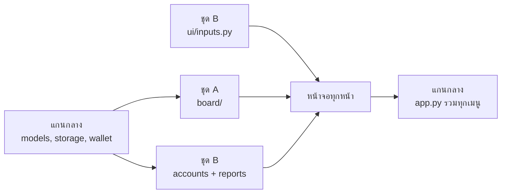

# เลือกชุดงาน

ยังไม่ได้เลือกชุด อ่านหน้านี้ก่อน จบแล้วไปอ่านไฟล์ของชุดที่เลือก

งานมี 3 ชุด ชุดแกนกลางเจ้าของ repo ทำเอง ที่เหลือให้อีกสองคนเลือกคนละชุด จะเอาชุด A หรือชุด B ก็ได้

## เทียบทั้ง 3 ชุด

| | แกนกลาง | ชุด A: บอร์ดประกาศ | ชุด B: ผู้ใช้ การรับข้อมูล และรายงาน |
| --- | --- | --- | --- |
| ใครทำ | เจ้าของ repo | เลือกได้ | เลือกได้ |
| ทำอะไร | class ข้อมูล อ่าน/เขียนไฟล์ ระบบแต้ม ตาราง เมนูหลัก | โพสต์ ค้นหา สมัครช่วย ส่งงาน ยืนยัน ปิดรับ | รับ input จากผู้ใช้ สมัคร/login สถิติ export รายงาน |
| ไฟล์ | `core/`, `wallet/`, `ui/display.py`, `app.py` | `board/` | `ui/inputs.py`, `accounts/`, `reports/` |
| function หลัก | 7 ตัว + 5 class | 6 ตัว + 4 หน้าจอ | 6 ตัว + 3 หน้าจอ |
| เหมาะกับใคร | – | ชอบคิดเงื่อนไขหลายข้อ อยากลุย logic หลักของโปรแกรม | อยากเริ่มจากงานเล็กที่ลองได้เลย ชอบทำหน้าจอให้ใช้ง่ายและสรุปตัวเลข |
| อ่านต่อ | [core.md](core.md) | [a-board.md](a-board.md) | [b-accounts-reports.md](b-accounts-reports.md) |

ชุด A มี rule เยอะกว่าหน่อย แต่ทุก function เดินแบบเดียวกัน คือเช็กเงื่อนไขให้ครบก่อน ผ่านแล้วค่อยแก้ data แล้วคืนผลออกไป ในไฟล์ของชุดมี step เขียนไว้ให้ทีละข้อ

ชุด B function แต่ละตัวเล็กและแยกกันชัด เป็นส่วนที่อาจารย์จะเห็นตอนลองพิมพ์ผิด กับตอนเปิดหน้าสถิติ

## แต่ละชุดทำเองตั้งแต่ต้นจนจบ

| | ต้องทำอะไร |
| --- | --- |
| code | function และหน้าจอในไฟล์ของชุดตัวเอง |
| test | run test case ของชุดตัวเองจริง จดผลแล้วแคปหน้าจอไว้ |
| รายงาน | อธิบาย function ของตัวเอง คู่มือหน้าจอของตัวเอง และผล test ของตัวเอง |
| คลิป | demo feature ของตัวเอง แล้วเปิด code อธิบายอย่างน้อย 1 function |
| ทั้งทีม | อ่าน PR ของเพื่อนให้เข้าใจภาพรวม (คน review และ merge คือเจ้าของ repo) และอธิบายภาพรวมของโปรแกรมได้ |

## ใครรอใคร

- ชุด A กับชุด B เริ่มได้เลยทั้งคู่ เพราะของที่ต้องเรียกใช้เป็นของแกนกลาง และสัญญาอยู่ใน `docs/05-contracts.md` ข้อ 2
- ทุกหน้าจอเรียก `ui/inputs.py` ของชุด B ชุด B ต้อง merge ไฟล์นี้ภายใน **22 พ.ย. 2569** จะได้ลองหน้าจอของทุกชุดได้

## เลือกยังไง

1. อ่านไฟล์ของทั้งสองชุดให้จบก่อน แล้วค่อยเลือก
2. ไปแท็บ Issues ของ repo เปิด Issue [#14](https://github.com/ZoFirsT/ChuayNoi/issues/14) ชื่อขึ้นต้น `[ชุด A]` หรือ [#15](https://github.com/ZoFirsT/ChuayNoi/issues/15) ชื่อขึ้นต้น `[ชุด B]` สองอันนี้ติด label `open-to-pick`
3. กด Assignees เลือก assign yourself แล้ว comment ว่า "เลือกชุดนี้"
4. ตัดสินให้จบภายใน **20 พ.ย. 2569** ถ้าสองคนอยากได้ชุดเดียวกัน คุยกันในกลุ่มก่อน
5. เจ้าของ repo จะ assign Issue งานย่อยรายสัปดาห์ของชุดนั้นให้ ดูงานแต่ละสัปดาห์ได้ในแท็บ Milestones

## Issue กับ label

| อะไร | ใช้ทำอะไร |
| --- | --- |
| Issue เลือกชุด (#14, #15) | ไว้เลือกชุด |
| Issue งานย่อยรายสัปดาห์ | งานที่ต้องเสร็จในแต่ละ Milestone ปิดเมื่อ PR สุดท้ายของสัปดาห์ merge แล้ว (PR สุดท้ายใส่ `Closes #เลข` ส่วน PR ก่อนหน้าใส่ `Refs #เลข`) |
| `pkg: core` / `pkg: A-board` / `pkg: B-accounts-reports` | บอกว่าเป็นงานของชุดไหน |
| `must` / `should` / `could` | ลำดับความสำคัญ ทำ `must` ให้ครบก่อน |
| `open-to-pick` | ชุดที่ยังไม่มีใครเลือก |
