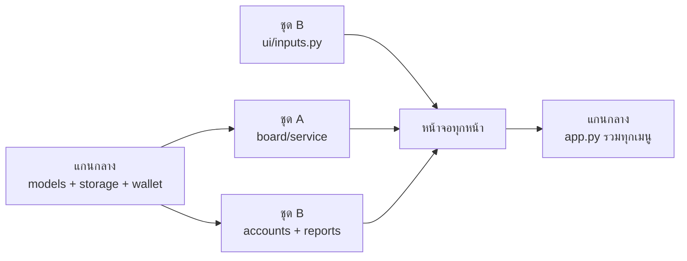

# เลือกชุดงาน

งานมี 3 ชุด ชุดแกนกลางเราทำเอง ที่เหลือให้อีกสองคนเลือกกันคนละชุด จะเอาชุด A หรือชุด B ก็ได้

## เทียบทั้ง 3 ชุด

| | แกนกลาง | ชุด A: บอร์ดประกาศ | ชุด B: ผู้ใช้ การรับข้อมูล และรายงาน |
| --- | --- | --- | --- |
| ใครทำ | เรา (เจ้าของ repo) | เลือกได้ | เลือกได้ |
| ทำอะไร | class ข้อมูล อ่าน/เขียน file ระบบแต้ม ตาราง เมนูหลัก | โพสต์ ค้นหา รับช่วย ส่งงาน ยืนยัน ปิดรับ | รับ input จากผู้ใช้ สมัคร/login สถิติ export รายงาน |
| File | `core/`, `wallet/`, `ui/display.py`, `app.py` | `board/` | `ui/inputs.py`, `accounts/`, `reports/` |
| Function หลัก | 7 ตัว + 5 class | 6 ตัว + 4 หน้าจอ | 6 ตัว + 3 หน้าจอ |
| ความยาก | ★★★ | ★★★ | ★★ |
| เหมาะกับใคร | - | ชอบคิดเงื่อนไขหลาย ๆ ข้อ อยากลุย logic หลักของโปรแกรม | อยากเริ่มจากงานเล็ก ๆ ที่ลองได้เลย ชอบทำหน้าจอให้ใช้ง่ายและสรุปตัวเลข |
| เริ่มได้เมื่อไหร่ | ได้เลย | `search_requests` เริ่มได้หลังแกนกลางเสร็จ (สัปดาห์ 1) | เริ่มได้เลย `ui/inputs.py` ไม่ต้องรอใคร |
| อ่านต่อ | [core.md](core.md) | [a-board.md](a-board.md) | [b-accounts-reports.md](b-accounts-reports.md) |

ชุด A rule เยอะกว่าหน่อย แต่ทุก function เป็น pattern เดียวกันหมด คือเช็กเงื่อนไขให้ครบก่อน ผ่านแล้วค่อยแก้ data แล้ว return ผลออกไป ใน doc มี step เขียนไว้ให้ทีละข้อแล้ว

ชุด B function แต่ละตัวเล็ก ๆ และแยกกันชัด เป็นส่วนที่อาจารย์จะเห็นตอนลองพิมพ์ผิด (เกณฑ์ส่วนที่ 1) กับตอนเปิดหน้าสถิติ

## แต่ละชุดทำเองตั้งแต่ต้นจนจบ

| | ต้องทำอะไร |
| --- | --- |
| โค้ด | function และหน้าจอใน file ของชุดตัวเอง |
| Test | run test case ของชุดตัวเองจริง ๆ จดผลแล้วแคปหน้าจอไว้ |
| รายงาน | อธิบาย function ของตัวเอง, คู่มือใช้หน้าจอของตัวเอง, ผล test ของตัวเอง |
| คลิป | demo feature ของตัวเอง แล้วเปิดโค้ดอธิบายอย่างน้อย 1 function |
| ทั้งทีม | review PR ของเพื่อน และอธิบายภาพรวมของโปรแกรมได้ |

## ใครรอใคร

- แกนกลางต้องเสร็จภายใน **สัปดาห์ 1** เพราะชุด A กับชุด B ต้องใช้ class ข้อมูลและระบบแต้ม
- ชุด B ต้องส่ง `ui/inputs.py` ให้ทันภายใน **26 พ.ย.** เพราะทุกหน้าจอต้องเรียกใช้

## เลือกยังไง

1. อ่าน doc ของทั้งสองชุดให้จบก่อน แล้วค่อยเลือก
2. ในแท็บ Issues ของ repo จะมี Issue ปักหมุดอยู่ด้านบน ชื่อขึ้นต้นด้วย `[ชุด A]` กับ `[ชุด B]` (ติด label `open-to-pick` ไว้)
3. เปิด Issue ของชุดที่เลือก กด Assignees แล้วเลือก assign yourself จากนั้น comment ว่า "เลือกชุดนี้"
4. เดี๋ยวเราจะ assign งานย่อยรายสัปดาห์ของชุดนั้นให้ ดูงานแต่ละสัปดาห์ได้ในแท็บ Milestones
5. ถ้าสองคนอยากได้ชุดเดียวกัน คุยกันในกลุ่มก่อน แล้วตัดสินให้จบภายใน **20 พ.ย. 2569**

## Issue กับ label

| ประเภท | ใช้ทำอะไร |
| --- | --- |
| Issue หลักของชุด (ปักหมุด) | ไว้เลือกชุด และดู checklist งานทั้งหมดของชุด |
| Issue งานย่อยรายสัปดาห์ | งานที่ต้องเสร็จในแต่ละ Milestone จะปิดก็ต่อเมื่อ PR ของงานนั้น merge แล้ว (ใส่ `Closes #เลข` ไว้ใน PR) |
| label `pkg: core` / `pkg: A-board` / `pkg: B-accounts-reports` | บอกว่าเป็นงานของชุดไหน |
| label `must` / `should` / `could` | ลำดับความสำคัญ ทำ `must` ให้ครบก่อน |
| label `open-to-pick` | ชุดที่ยังไม่มีใครเลือก |
